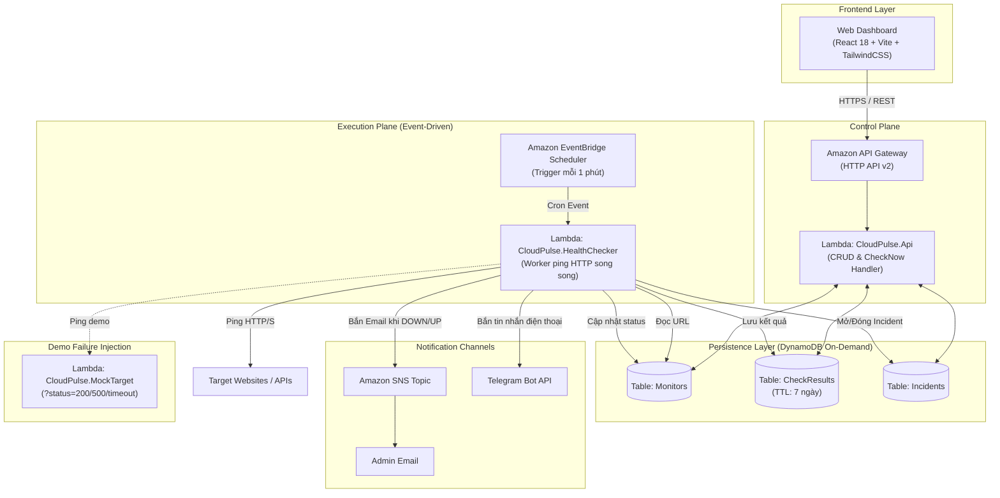

# CloudPulse — Đặc Tả Dự Án & Product Discovery

**Hệ thống giám sát website và cảnh báo sự cố tự động trên nền tảng AWS Serverless**

- **Môn học**: Điện toán đám mây (Cloud Computing)
- **Ngày cập nhật**: 27/10/2026
- **Phiên bản**: 2.0 (Official Discovery & Technical Specification)
- **Trạng thái**: Đã chuẩn hóa toàn diện Phase 1 — Discovery & Sẵn sàng triển khai.

---

## PHẦN I: PHASE 1 — PRODUCT DISCOVERY (LÀM CÁI GÌ & TẠI SAO?)

Đây là giai đoạn mấu chốt nhằm xác định rõ giá trị thực tế của dự án, đối tượng phục vụ, lợi thế cạnh tranh và các chỉ số đo lường thành công trước khi bắt tay vào viết mã nguồn.

### 1. Vấn đề thực tế (Problem Statement)
* **Thực trạng**: Các website, cổng thanh toán và API dịch vụ số có thể bị gián đoạn bất kỳ lúc nào do:
  * Lỗi máy chủ hoặc mã nguồn nội bộ (HTTP 500, 502, 503).
  * Nghẽn tài nguyên dẫn đến treo kết nối (Request Timeout).
  * Sự cố mạng, lỗi phân giải tên miền (DNS) hoặc chứng chỉ SSL hết hạn.
* **Hậu quả**: Nếu không có cơ chế giám sát liên tục 24/7, sự cố chỉ được nhận biết khi **người dùng hoặc khách hàng phàn nàn**. Điều này gây ra:
  * Tổn thất doanh thu trực tiếp theo từng phút gián đoạn (Downtime).
  * Suy giảm nghiêm trọng uy tín và trải nghiệm của người dùng.
  * Đội ngũ kỹ thuật rơi vào thế bị động, mất nhiều thời gian điều tra nguyên nhân gốc rễ (Root Cause).

### 2. Chân dung Đối tượng Sử dụng (Target Audience / Personas)
CloudPulse hướng tới giải quyết bài toán cho 2 nhóm đối tượng cụ thể:
1. **Startup công nghệ và Doanh nghiệp vừa & nhỏ (SMEs)**:
   * Triển khai ứng dụng trên Cloud nhưng chưa có ngân sách hàng nghìn USD/tháng để thuê đội ngũ SRE/DevOps trực ca 24/7.
   * Cần một giải pháp giám sát tự động, độ tin cậy cao với chi phí vận hành tiệm cận \$0.
2. **Lập trình viên độc lập & Nhóm phát triển phần mềm (Indie Hackers / Software Agencies)**:
   * Quản lý từ 3 đến 20 website/API của nhiều khách hàng khác nhau.
   * Cần nhận cảnh báo sự cố tức thời về Email hoặc tin nhắn điện thoại cá nhân (Telegram) ngay khi có biến cố, không cần cài đặt các phần mềm giám sát (agent) nặng nề lên máy chủ của khách hàng.

### 3. Phân tích Các Giải pháp Hiện tại & Nhược điểm (Existing Alternatives)

| Giải pháp hiện hành | Cách thức hoạt động | Nhược điểm chí mạng |
| :--- | :--- | :--- |
| **1. Kiểm tra thủ công (Manual Checks)** | Lập trình viên thỉnh thoảng mở web, F5 hoặc chạy lệnh `curl`. | • Hoàn toàn bị động, không khả thi vào ban đêm hoặc ngày nghỉ.<br>• Khi phát hiện thì khách hàng đã rời bỏ dịch vụ. |
| **2. Dịch vụ SaaS thương mại** *(UptimeRobot, BetterStack, Pingdom)* | Thuê dịch vụ bên ngoài ping định kỳ. | • Gói Free bị giới hạn khắc nghiệt (chỉ cho check 5–15 phút/lần, giới hạn số endpoint).<br>• Muốn check 1 phút/lần hoặc dùng SMS/Webhook thì phí rất đắt (\$20 – \$70/tháng).<br>• Dữ liệu log và lịch sử sự cố bị bên thứ ba nắm giữ (Vendor Lock-in). |
| **3. Công cụ AWS Native** *(CloudWatch Synthetics Canaries + Route 53)* | Dùng dịch vụ canaries giả lập hành vi người dùng trên AWS. | • Cấu hình rất phức tạp (yêu cầu viết script Puppeteer/Node.js).<br>• **Chi phí rất đắt**: 1 Canary chạy mỗi 1 phút tiêu tốn khoảng **\$50 – \$70/tháng** (vượt xa ngân sách đồ án sinh viên/SME). |
| **4. Tự host Prometheus / Zabbix / Grafana trên EC2** | Dựng máy chủ riêng chạy Blackbox Exporter. | • Tốn chi phí cố định nuôi server EC2 chạy 24/7 (tối thiểu \$10 – \$20/tháng dù không có lỗi).<br>• Tốn công quản trị hạ tầng, vá lỗi OS, lo sao lưu dữ liệu. |

### 4. Đề xuất Giá trị Độc nhất của CloudPulse (Unique Value Proposition)

CloudPulse giải quyết triệt để các hạn chế trên bằng kiến trúc **Cloud-Native / Serverless & Event-Driven**:

1. **Chi phí tiệm cận \$0 (100% AWS Free Tier)**:
   * Hệ thống vận hành theo mô hình trả tiền theo nhu cầu sử dụng thực tế (Pay-as-you-go). Nhờ kết hợp **EventBridge Scheduler + Lambda + DynamoDB On-Demand**, toàn bộ chi phí kiểm tra, lưu trữ và cảnh báo đều nằm trọn trong hạn mức miễn phí hàng tháng của AWS.
2. **Triển khai siêu tốc, không cần cài đặt (Zero-Agent)**:
   * Người quản trị chỉ cần nhập URL/API endpoint trên giao diện Dashboard là hệ thống tự động kích hoạt giám sát, không cần can thiệp hay cài thêm bất kỳ phần mềm nào vào mã nguồn website đích.
3. **Cơ chế chống báo động giả thông minh (Smart State Machine)**:
   * Phân tách rạch ròi giữa kết quả kiểm tra từng lần (`SUCCESS`/`FAIL`) và trạng thái sức khỏe tổng thể (`UP`/`DOWN`).
   * Chỉ xác nhận sự cố và phát cảnh báo khi đạt **ngưỡng 2 lần lỗi liên tiếp**, loại bỏ hoàn toàn các báo động rác do mạng Internet chập chờn nhất thời.
4. **Cảnh báo đa kênh tức thời (Multi-Channel Alerting)**:
   * Kết hợp song song **Amazon SNS (Email)** chuẩn mực doanh nghiệp và **Telegram Bot Webhook** nảy chuông điện thoại tức thì.
   * Tự động gửi thông báo khôi phục (Recovery Alert) kèm tổng thời gian gián đoạn (Downtime Duration).
5. **Tự chủ dữ liệu & Tối ưu lưu trữ (Self-Hosted & Auto-Expiring)**:
   * Toàn bộ dữ liệu lịch sử nằm an toàn trong tài khoản AWS của người dùng.
   * Tính năng **DynamoDB TTL** tự động dọn dẹp các bản ghi kiểm tra cũ sau 7 ngày, đảm bảo không bao giờ phát sinh chi phí phình dữ liệu.

### 5. Tiêu chí Thành công & Đo lường (Success Metrics / KPIs)

Dự án được định nghĩa là thành công khi đạt được các chỉ số định lượng sau:

#### A. Chỉ số Vận hành & Sản phẩm (Operational KPIs):
* **MTTD (Mean Time to Detect)**: Thời gian từ khi endpoint đích sập đến khi hệ thống xác nhận sự cố **$\le 2$ phút** (với tần suất check 1 phút/lần).
* **Alert Latency**: Cảnh báo gửi đến hộp thư Email và ứng dụng Telegram trong vòng **$\le 5$ giây** sau khi hệ thống chuyển trạng thái `DOWN`.
* **Tỷ lệ báo động sai (False Positive Rate)**: Giảm xuống **0%** đối với các sự cố mạng chập chờn dưới 1 phút nhờ cơ chế ngưỡng 2 lần lỗi liên tiếp.
* **Chi phí thực tế (Cost Efficiency)**: Tổng hóa đơn AWS duy trì ở mức **\$0.00/tháng** cho quy mô thử nghiệm dưới 10 websites.

#### B. Chỉ số Đồ án & Học thuật (Academic KPIs):
* **Hạ tầng dạng mã (IaC)**: 100% tài nguyên AWS (DynamoDB, Lambda, SNS, API Gateway, Scheduler, IAM) được khởi tạo tự động bằng **AWS SAM**, cho phép deploy và destroy chỉ với 1 dòng lệnh.
* **Bảo mật mạng (Security)**: Tích hợp module kiểm tra chống tấn công **SSRF (Server-Side Request Forgery)**, ngăn chặn triệt để hành vi quét cổng IP nội bộ và AWS Instance Metadata Service (`169.254.169.254`).
* **Kịch bản Demo chuẩn mực**: Trình diễn mượt mà vòng đời sự cố 7 bước trước hội đồng chấm thi mà không phụ thuộc vào rủi ro đường truyền bên ngoài nhờ dịch vụ `MockTarget`.

---

## PHẦN II: MỤC TIÊU & PHẠM VI DỰ ÁN (SCOPE & MVP)

### 1. Phạm vi phiên bản tối thiểu (MVP Core Features)
1. **Quản lý Endpoints**: Thêm, xem danh sách, xóa website/API cần theo dõi.
2. **Kiểm tra tự động định kỳ**: EventBridge kích hoạt Lambda gửi HTTP/HTTPS request mỗi 1 phút.
3. **Phát hiện & Phân loại lỗi**: Ghi nhận mã HTTP (`2xx`, `4xx`, `5xx`), lỗi kết nối mạng hoặc Timeout (> 5.000 ms).
4. **Xác nhận sự cố & Cảnh báo**:
   * Chuyển trạng thái sang `DOWN` khi lỗi 2 lần liên tiếp.
   * Gửi thông báo sự cố qua **Amazon SNS (Email)** và **Telegram Bot**.
   * Gửi thông báo khôi phục khi website hoạt động bình thường trở lại.
5. **Nút "Check Now"**: Cho phép người dùng bấm kiểm tra ngay lập tức trên Dashboard phục vụ việc chấm demo không phải chờ đợi cron.
6. **Dịch vụ MockTarget nội bộ**: Hàm Lambda hỗ trợ giả lập lỗi (`?status=200`, `?status=500`, `?delay=7000`) để chủ động tạo sự cố trong buổi thuyết trình.
7. **Dashboard Trực quan**: Thống kê Uptime (%), Biểu đồ độ trễ phản hồi (Response Time ms) theo thời gian thực và Nhật ký sự cố (Incidents).

### 2. Ngoài phạm vi dự án (Out of Scope)
* Chưa tích hợp hệ thống đăng nhập tài khoản người dùng (AWS Cognito) — Dashboard mở nội bộ phục vụ bài tập môn học.
* Không tự can thiệp sửa mã nguồn hay khởi động lại máy chủ của website bên thứ ba.
* Không giám sát tài nguyên phần cứng chuyên sâu bên trong máy chủ đích (CPU/RAM).

---

## PHẦN III: KIẾN TRÚC HỆ THỐNG & CÔNG NGHỆ



### Bảng công nghệ lựa chọn:
* **Hạ tầng (IaC)**: **AWS SAM (Serverless Application Model)**.
* **Cơ sở dữ liệu**: **Amazon DynamoDB (On-Demand)** gồm 3 bảng độc lập: `Monitors`, `CheckResults` (TTL 7 ngày), `Incidents`.
* **Lập lịch**: **Amazon EventBridge Scheduler** (tần suất `rate(1 minute)`).
* **Cảnh báo**: **Amazon SNS** + **Telegram Bot API**.

---

## PHẦN IV: KỊCH BẢN DEMO THỰC CHIẾN 7 BƯỚC

1. **Bước 1 — Bình thường**: Mở Dashboard, quan sát endpoint MockTarget đang ở trạng thái `UP` màu xanh, độ trễ phản hồi ổn định ~50ms.
2. **Bước 2 — Gây lỗi chủ động**: Truy cập endpoint MockTarget trên tab trình duyệt khác với tham số `?status=500`.
3. **Bước 3 — Lỗi lượt 1**: Bấm nút **"Check Now"** (hoặc đợi EventBridge chạy). Hệ thống ghi nhận 1 lượt FAIL (`consecutiveFailures = 1`), trạng thái vẫn giữ `UP` (chưa đạt ngưỡng cảnh báo).
4. **Bước 4 — Xác nhận DOWN & Cảnh báo**: Bấm "Check Now" lần thứ hai. Đạt ngưỡng 2 lần lỗi liên tiếp $\rightarrow$ Hệ thống chuyển sang `DOWN` màu đỏ $\rightarrow$ Nhận được Email cảnh báo từ **Amazon SNS** và tin nhắn chuông báo từ **Telegram Bot**.
5. **Bước 5 — Kiểm tra Incident**: Mở chi tiết sự cố trên Dashboard, quan sát Incident mới được mở với trạng thái `OPEN` ghi rõ thời gian bắt đầu và mã lỗi `HTTP 500`.
6. **Bước 6 — Khôi phục**: Đổi tham số MockTarget về `?status=200`, bấm "Check Now" $\rightarrow$ Dashboard chuyển lại màu Xanh (`UP`), Incident chuyển thành `RESOLVED`, nhận tin nhắn thông báo website đã hồi phục kèm thời gian downtime.
7. **Bước 7 — Tổng kết**: Trình chiếu CloudWatch Logs ghi lại toàn bộ nhật ký thực thi của Lambda và bảng kê chi phí Cloud \$0.

---

## PHẦN V: KẾ HOẠCH BẢO MẬT & DỌN DẸP HẠ TẦNG

### 1. Bảo mật tối thiểu (SSRF & Least Privilege)
* **Chống SSRF**: Module `UrlValidator` bắt buộc kiểm tra URL trước khi lưu hoặc gửi request. Chặn tuyệt đối IP localhost (`127.0.0.1`), dải Private IP (`10.0.0.0/8`, `172.16.0.0/12`, `192.168.0.0/16`) và địa chỉ AWS Metadata (`169.254.169.254`).
* **IAM Least Privilege**: Các hàm Lambda chỉ được cấp quyền đọc/ghi trên đúng 3 bảng DynamoDB và quyền `Publish` trên đúng Topic SNS của ứng dụng.

### 2. Dọn dẹp tài nguyên (Cleanup)
Sau khi kết thúc môn học, toàn bộ tài nguyên được xóa sạch bằng lệnh:
```bash
sam delete --stack-name cloudpulse-app
```
Đảm bảo tài khoản AWS cá nhân không phát sinh bất kỳ khoản phí ngoài ý muốn nào.
