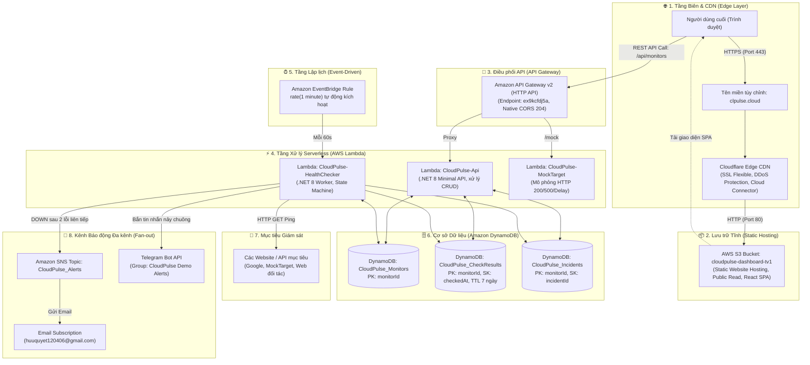

# CloudPulse — Website & API Health Monitoring on AWS

[](https://aws.amazon.com/)
[](https://dotnet.microsoft.com/)
[](https://vitejs.dev/)
[](https://aws.amazon.com/serverless/sam/)
[]()
[](LICENSE)

> **CloudPulse** là hệ thống giám sát tính khả dụng (Uptime) và hiệu năng (Response Time) của Website/API dựa trên nền tảng **AWS Serverless & Event-Driven Architecture**. Hệ thống tự động kiểm tra định kỳ mỗi 1 phút, phát hiện lỗi mạng/sự cố máy chủ, cảnh báo tức thời đa kênh (**Email qua Amazon SNS** & **Tin nhắn cuộc gọi qua Telegram Bot**), đồng thời cung cấp Dashboard trực quan cho người quản trị với chi phí vận hành tiệm cận **$0 (100% AWS Free Tier & FinOps)**.

---

## 🌐 Hệ Thống Thực Tế Đã Triển Khai (Live Production Endpoints)

| Tài Nguyên | Địa Chỉ Trực Tuyến | Ghi Chú Kỹ Thuật |
| :--- | :--- | :--- |
| **Custom Domain (Production)** | 🔗 **[https://clpulse.cloud](https://clpulse.cloud)** | Tên miền chính thức, bảo mật **HTTPS** qua mạng lưới **Cloudflare CDN Edge** |
| **S3 Static Website (Origin)** | 🔗 [cloudpulse-dashboard-tv1 S3 Website](http://cloudpulse-dashboard-tv1.s3-website-ap-southeast-1.amazonaws.com) | Single Page Application (React/Vite) lưu trữ trên AWS S3 tại `ap-southeast-1` |
| **Amazon API Gateway v2** | `https://ex9kcfdj5a.execute-api.ap-southeast-1.amazonaws.com` | HTTP API v2 kết nối trực tiếp với Lambda `CloudPulse-Api` |
| **Dịch vụ MockTarget Demo** | `https://ex9kcfdj5a.execute-api.ap-southeast-1.amazonaws.com/mock` | Hỗ trợ mô phỏng mã trạng thái HTTP 200, 500 và độ trễ phục vụ diễn tập |
| **Amazon SNS Alerts Topic** | `arn:aws:sns:ap-southeast-1:180459766853:CloudPulse_Alerts` | Kênh phát tán email sự cố tức thời đến danh sách quản trị viên |

---

## 📑 Mục Lục Tài Liệu Kỹ Thuật Dự Án (`docs/`)

Toàn bộ quy trình phân tích, thiết kế, triển khai và kiểm thử được quản lý nghiêm ngặt tại thư mục `docs/`:

1. 📖 **[Đặc tả Yêu cầu Hệ thống (Requirements)](./docs/requirements.md)**: Danh sách đầy đủ yêu cầu chức năng (MVP), yêu cầu phi chức năng (NFR) và phạm vi ngoài dự án (Out of Scope).
2. 🔄 **[Các Luồng Nghiệp vụ Chính (Use Cases)](./docs/use-cases.md)**: Kịch bản và sơ đồ tuần tự (Sequence Diagrams) cho 7 luồng nghiệp vụ cốt lõi.
3. ✅ **[Tiêu chí Nghiệm thu Chi tiết (Acceptance Criteria)](./docs/acceptance-criteria.md)**: Bộ điều kiện nghiệm thu theo chuẩn Given-When-Then cho từng tính năng.
4. 👥 **[Ma trận Phân công Nhiệm vụ (Duties & RACI Matrix)](./docs/duties.md)**: Bảng phân chia công việc chi tiết cho 5 thành viên trong 4 tuần.
5. 🏛️ **[Nhật ký Trưởng nhóm & Cẩm nang Vấn đáp (TV1.md)](./docs/TV1.md)**: Hồ sơ chi tiết về kiến trúc đám mây, các quyết định ADR, xử lý sự cố thực chiến và cẩm nang vấn đáp điểm 10 với giảng viên.
6. 📊 **[Hồ sơ Báo cáo Tuần & Slide (TV5 Report)](./docs/report/)**: File báo cáo Word hoàn chỉnh (`CloudPulse_BaoCao_TV5_Tuan3.docx`), slide thuyết trình và bộ ảnh minh chứng (`docs/evidence/`).

---

## 🏛️ Kiến Trúc Hệ Thống (System Architecture)

Hệ thống được thiết kế theo mô hình **Serverless 100%**, tách biệt hoàn toàn giữa các tầng:



---

## ⚡ Các Tính Năng Cốt Lõi (Core Features)

1. **Giám sát Tự động Định kỳ**: Tự động kiểm tra HTTP/HTTPS mỗi 1 phút bằng EventBridge và Lambda mà không cần duy trì bất kỳ máy chủ nào.
2. **Cơ chế Chống Báo Động Giả (Smart State Machine)**: Đúng ngưỡng **2 lần lỗi liên tiếp** mới xác nhận `DOWN` và mở sự cố `OPEN`, tránh spam cảnh báo khi mạng internet chập chờn nhất thời.
3. **Cảnh báo Đa kênh Tức thời**: Gửi thông báo song song đến cả **Email (SNS)** và **Telegram Bot** trong vòng $\le 5$ giây sau khi xác nhận sự cố; tự động gửi thông báo khôi phục khi website `UP` trở lại.
4. **Nút "Check Now" Kiểm tra Tức thời**: Kích hoạt kiểm tra ngay lập tức trên Dashboard trong vòng 1-2 giây phục vụ việc chấm thi demo trực tiếp.
5. **Dịch vụ MockTarget Nội bộ**: Hàm Lambda hỗ trợ điều khiển tạo lỗi chủ động (`?status=200`, `?status=500`, `?delay=7000`) để demo không phụ thuộc vào Internet bên ngoài.
6. **Bảo vệ Chống Tấn công SSRF**: Tự động chặn các URL trỏ về IP nội bộ (`127.0.0.1`, `10.x`, `192.168.x`) hoặc AWS Instance Metadata (`169.254.169.254`).
7. **Tự Động Dọn Dẹp Rác Dữ Liệu (TTL)**: Bản ghi kết quả đo cũ tự động hủy sau 7 ngày bằng **DynamoDB TTL**, không làm phình dung lượng lưu trữ (Zero Data Bloat).
8. **Đồng Bộ Múi Giờ Việt Nam (UTC+7)**: Toàn bộ biểu đồ độ trễ và đồng hồ hiển thị trên Dashboard được đồng bộ chính xác theo giờ Việt Nam.

---

## 📂 Cơ Cấu Thư Mục Dự Án (Repository Structure)

```text
CloudPulse/
├── backend/                               # Mã nguồn Backend (.NET 8 C#)
│   ├── src/
│   │   ├── CloudPulse.Api/                # ASP.NET Core Minimal API (Lambda Handler)
│   │   ├── CloudPulse.HealthChecker/      # Background Worker Engine (EventBridge Handler)
│   │   ├── CloudPulse.MockTarget/         # Dịch vụ giả lập HTTP 200/500/Delay
│   │   └── CloudPulse.core/               # Shared Entities, DTOs, SSRF Validation
│   └── test/
│       ├── CloudPulse.core.Tests/         # 51 Unit Tests cho Core & SSRF (100% Passed)
│       └── CloudPulse.HealthChecker.Tests/# 45 Unit Tests cho State Machine (100% Passed)
├── frontend/                              # Mã nguồn Giao diện (React 18 + Vite + Tailwind)
│   ├── src/
│   │   ├── components/                    # Navbar, MonitorList, LatencyChart, Incidents
│   │   ├── api/client.js                  # API Client kết nối AWS API Gateway & Mock Fallback
│   │   └── App.jsx                        # Giao diện chính điều phối trạng thái
│   └── dist/                              # Bản build production triển khai lên S3
├── docs/                                  # Toàn bộ tài liệu kỹ thuật & Báo cáo đồ án
│   ├── TV1.md -> TV5.md                   # Nhật ký hoạt động & cẩm nang vấn đáp từng thành viên
│   ├── requirements.md                    # Đặc tả yêu cầu chức năng & phi chức năng
│   ├── acceptance-criteria.md             # Tiêu chí nghiệm thu chi tiết
│   ├── duties.md                          # Bảng phân công nhiệm vụ 5 thành viên (RACI)
│   └── report/                            # File Báo cáo Word chính thức & minh chứng FinOps
├── template.yaml                          # Hạ tầng Infrastructure as Code (AWS SAM)
└── README.md                              # Hướng dẫn tổng quan dự án
```

---

## 🧪 Hướng Dẫn Chạy & Kiểm Thử Toàn Diện (Testing Guide)

Dự án đã được tích hợp bộ kiểm thử tự động toàn diện, vượt qua 100% các tiêu chí chất lượng:

### 1. Kiểm tra Backend Unit Tests (96 Tests Passed ✅)
```bash
# Kiểm tra 51 tests cho Core & SSRF Validator
dotnet test backend/test/CloudPulse.core.Tests/Cloudpulse.core.Tests.csproj

# Kiểm tra 45 tests cho State Machine & HealthChecker Engine
dotnet test backend/test/CloudPulse.HealthChecker.Tests/CloudPulse.HealthChecker.Tests.csproj
```
*(Kết quả: **96/96 Unit Tests PASSED 100%**, thời gian thực thi < 3 giây).*

### 2. Chạy Thử Nghiệm MockTarget Smoke Tests
```bash
dotnet run --project backend/tests/CloudPulse.MockTarget.SmokeTests/CloudPulse.MockTarget.SmokeTests.csproj
```
*(Xác nhận: Phản hồi chuẩn xác HTTP 200, HTTP 500 và độ trễ trễ 7 giây).*

### 3. Kiểm Tra Mã Nguồn Frontend (Lint & Build)
```bash
cd frontend
npm run lint    # Kiểm tra chuẩn cú pháp ESLint (0 errors, 0 warnings)
npm run build   # Đóng gói bản Production tối ưu (Vite)
```

### 4. Kiểm Tra Tính Hợp Lệ Của Hạ Tầng AWS SAM
```bash
sam validate
```
*(Xác nhận: File `template.yaml` vượt qua 100% tiêu chuẩn AWS CloudFormation & Serverless Application Model).*

---

## 🎭 Kịch Bản Diễn Tập Demo 7 Bước (Demo Walkthrough)

Dành cho buổi báo cáo và bảo vệ đồ án trước Hội đồng:

1. **Bước 1: Giới thiệu Tổng quan**: Mở `https://clpulse.cloud`, chỉ ra các chỉ số tổng quan (Uptime %, Open Critical, Endpoints count, p95 latency) và đồng hồ UTC+7 thời gian thực.
2. **Bước 2: Thêm Endpoint Bình Thường**: Bấm nút **"+ Thêm Monitor"**, thêm URL `Mock 200` (`.../mock`) ➔ Hệ thống kiểm tra và hiển thị trạng thái `UP` (màu xanh).
3. **Bước 3: Kiểm thử Nút "Check Now"**: Bấm nút "Check Now" tại dòng monitor ➔ Hệ thống đo đạc thời gian thực và nảy toast thông báo: `Kiểm tra OK: 45 ms` trong vòng 1-2 giây.
4. **Bước 4: Kích hoạt Sự cố Thực tế**: Thêm hoặc chuyển endpoint sang `Mock 500` (`.../mock?status=500`). Sau 2 lượt kiểm tra liên tiếp của cron 1 phút ➔ Hệ thống tự động chuyển trạng thái sang `DOWN` (màu đỏ) và mở một Incident `OPEN`.
5. **Bước 5: Minh chứng Cảnh báo Đa kênh**:
   * Mở hòm thư Gmail quản trị viên: Xem email cảnh báo `[CloudPulse DOWN]` do **Amazon SNS** gửi về.
   * Mở ứng dụng Telegram trên điện thoại: Xem tin nhắn cảnh báo có nảy chuông từ **CloudPulse Alerts Bot**.
6. **Bước 6: Khôi phục Sự cố (Self-Healing / Recovery)**: Đổi endpoint về trạng thái bình thường (HTTP 200) ➔ Hệ thống tự động chuyển lại `UP`, tự động đóng Incident (`RESOLVED`), tính toán chính xác tổng số giây downtime và gửi thông báo phục hồi `[CloudPulse RECOVERED]`.
7. **Bước 7: Trực quan hóa & Minh chứng FinOps**:
   * Rê chuột vào biểu đồ **LatencyChart** xem biến thiên thời gian phản hồi (ms) và các chỉ số MIN / AVG / MAX.
   * Trình chiếu hóa đơn AWS tháng 11/2026 đạt đúng **$0.00 USD**, minh chứng gói Credit tài trợ $120.00 được bảo toàn nguyên vẹn $119.97.

---

## 👥 Nhóm Thực Hiện & Phân Công Trách Nhiệm

* **Môn học**: Điện toán đám mây (Cloud Computing)
* **Quy mô**: 5 thành viên | **Thời gian hoàn thiện**: 4 tuần

| Thành Viên | Vai Trò Chính | Nhiệm Vụ Đảm Nhận & Đóng Góp Cốt Lõi |
| :--- | :--- | :--- |
| **TV1: Trần Hữu Quyết** | **Trưởng nhóm / Cloud Architect & DevOps** | Thiết kế kiến trúc Serverless, soạn thảo `template.yaml` (AWS SAM), cấu hình IAM Least Privilege, triển khai `sam deploy` lên AWS, cấu hình S3 Website Hosting, tên miền `clpulse.cloud` qua Cloudflare CDN, quản lý Git, quản trị tài chính FinOps và điều phối kỹ thuật. |
| **TV2: [Thành viên 2]** | **Backend Core Engine** | Lập trình Lambda `CloudPulse.HealthChecker`, xây dựng bộ máy trạng thái (State Machine) chống báo động giả với ngưỡng 2 lần lỗi liên tiếp, tích hợp phát tán email qua Amazon SNS và tích hợp nảy chuông điện thoại qua Telegram Bot API. |
| **TV3: [Thành viên 3]** | **Backend REST API & Mock Target** | Xây dựng REST API bằng ASP.NET Core Minimal API trên Lambda `CloudPulse.Api`, viết API đo đạc tức thời cho nút "Check Now", xây dựng dịch vụ giả lập lỗi `CloudPulse.MockTarget` (`?status=200/500`, `?delay=7000`) phục vụ kịch bản demo. |
| **TV4: [Thành viên 4]** | **Frontend Lead (React + Vite)** | Khởi tạo dự án Frontend React 18 + Tailwind CSS, xây dựng layout Dashboard chuẩn Light Theme, phát triển Navbar (đồng hồ UTC+7, nút Sync), bảng thống kê StatsOverview, danh sách MonitorList (hiệu ứng sóng Radar Ping) và popup thêm monitor. |
| **TV5: [Thành viên 5]** | **Frontend Metrics & Documentation** | Lập trình biểu đồ biến thiên độ trễ LatencyChart (Recharts), bảng lịch sử sự cố IncidentHistory, thiết lập CloudWatch Dashboard log, biên soạn tài liệu Báo cáo Đồ án Word (`CloudPulse_BaoCao_TV5_Tuan3.docx`) và Slide thuyết trình. |

---

## 📄 Bản Quyền & Giấy Phép

Dự án được phát hành theo giấy phép **MIT License** — xem chi tiết tại file [LICENSE](LICENSE). Toàn bộ mã nguồn, tài liệu thiết kế và kịch bản kiểm thử được bảo lưu bản quyền học thuật bởi Nhóm CloudPulse (2026).
