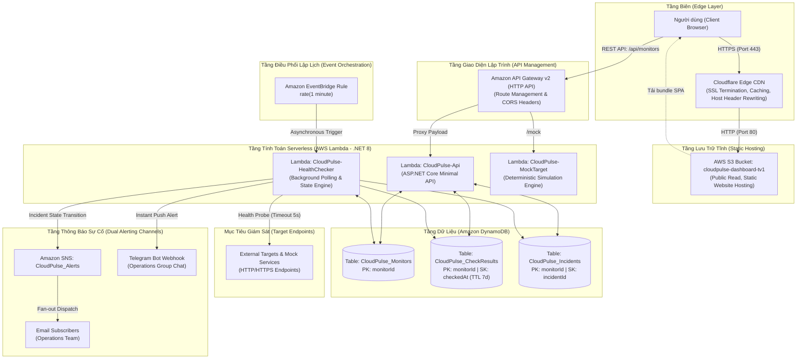

# CloudPulse — Serverless Health & Latency Monitoring Platform

[](https://aws.amazon.com/)
[](https://dotnet.microsoft.com/)
[](https://vitejs.dev/)
[](https://aws.amazon.com/serverless/sam/)
[-success?style=flat-square)]()
[](LICENSE)

**CloudPulse** là nền tảng giám sát tính khả dụng (Uptime) và hiệu năng (Response Time) cho các dịch vụ web và API, xây dựng hoàn toàn trên kiến trúc **Serverless & Event-Driven** của Amazon Web Services (AWS). Hệ thống thực hiện thăm dò định kỳ độc lập, xác thực trạng thái qua bộ máy trạng thái (State Machine) lọc báo động giả, phát tán cảnh báo sự cố đa kênh (Amazon SNS Email và Telegram Bot) và hiển thị chỉ số thời gian thực trên giao diện điều khiển (SPA).

Hạ tầng được quản lý 100% dưới dạng mã (**Infrastructure as Code — AWS SAM**) với mô hình chi phí tiệm cận **$0.00 USD/tháng** tuân thủ tuyệt đối định mức AWS Free Tier.

---

## 1. Môi Trường Triển Khai Thực Tế (Live Production Endpoints)

| Hạng mục | Địa chỉ Endpoint | Giao thức / Cấu hình | Vùng (Region) |
| :--- | :--- | :--- | :--- |
| **Custom Domain** | [https://clpulse.cloud](https://clpulse.cloud) | HTTPS / TLS 1.3 qua Cloudflare Edge CDN | Toàn cầu (Edge) |
| **S3 Static Website (Origin)** | [cloudpulse-dashboard-tv1](http://cloudpulse-dashboard-tv1.s3-website-ap-southeast-1.amazonaws.com) | HTTP (Port 80) — React 18 SPA Hosting | `ap-southeast-1` |
| **Amazon API Gateway v2** | `https://ex9kcfdj5a.execute-api.ap-southeast-1.amazonaws.com` | HTTP API v2, tích hợp Native CORS | `ap-southeast-1` |
| **Mock Target Service** | `https://ex9kcfdj5a.execute-api.ap-southeast-1.amazonaws.com/mock` | Hỗ trợ tham số `?status=200`, `?status=500`, `?delay=7000` | `ap-southeast-1` |
| **Amazon SNS Topic** | `arn:aws:sns:ap-southeast-1:180459766853:CloudPulse_Alerts` | Standard Pub/Sub Topic cho Email Fan-out | `ap-southeast-1` |

---

## 2. Kiến Trúc Kỹ Thuật (System Architecture)

Hệ thống tuân thủ nguyên tắc phân rã dịch vụ lỏng (Loose Coupling), phân tách độc lập giữa luồng thăm dò nền (Background Worker), luồng xử lý API quản trị và tầng lưu trữ dữ liệu chuỗi thời gian (Time-series Storage).



---

## 3. Đặc Điểm Thiết Kế Then Chốt (Key Engineering Principles)

### 3.1. Bộ Máy Trạng Thái Khử Nhiễu (Debounced State Machine)
* **Nguyên tắc ngưỡng 2 chu kỳ**: Hệ thống chỉ xác nhận chuyển trạng thái sang `DOWN` và kích hoạt báo động khi xảy ra **ít nhất 2 lần thất bại liên tiếp** ($N \ge 2$).
* **Khử bão cảnh báo (Anti-Alert Fatigue)**: Trong suốt thời gian website duy trì trạng thái `DOWN`, hệ thống duy trì theo dõi nhưng không gửi thêm thông báo lặp lại ở các chu kỳ kế tiếp.
* **Tự động đóng sự cố (Self-Healing Closure)**: Khi endpoint phản hồi HTTP thành công trở lại, trạng thái tự động chuyển `UP`, sự cố chuyển sang `RESOLVED`, hệ thống tính toán chính xác tổng thời gian gián đoạn (`downtimeSeconds`) và gửi duy nhất 1 bản tin thông báo hồi phục.

### 3.2. Phòng Vệ Chiều Sâu Chống Tấn Công SSRF (SSRF Defense-in-Depth)
* Tầng ứng dụng (`UrlValidator.cs`) phân giải DNS và đối soát địa chỉ IP trước khi thực hiện kết nối:
  * Từ chối toàn bộ dải IP riêng theo RFC 1918 (`10.0.0.0/8`, `172.16.0.0/12`, `192.168.0.0/16`).
  * Từ chối dải Loopback (`127.0.0.0/8`) và IPv6 nội bộ (`::1`).
  * Từ chối dải Link-Local (`169.254.0.0/16`) nhằm ngăn chặn triệt để nguy cơ trích xuất thông tin định danh máy chủ ảo thông qua AWS Instance Metadata Service (IMDS).
* Bộ kiểm thử gồm **51 bài test chuyên biệt** kiểm chứng toàn diện mọi kỹ thuật bypass IP (số thập phân, octal, hex, IPv6-mapped).

### 3.3. Tối Ưu Hóa Dữ Liệu & FinOps (Data Lifecycle & Cost Management)
* **DynamoDB On-Demand Capacity**: Tự động co giãn theo lưu lượng thực tế, không tiêu tốn chi phí dự phòng tài nguyên.
* **Tự động thu hồi bộ nhớ (TTL Eviction)**: Bảng `CloudPulse_CheckResults` kích hoạt thuộc tính Time-To-Live trên trường `expireAt = checkedAt + 7 days`. Cơ chế ngầm của AWS tự động xóa sạch các bản ghi lịch sử cũ mà không phát sinh chi phí đọc/ghi và không cần tiến trình dọn dẹp riêng.
* **Phân phối tầng biên (Edge Caching)**: Toàn bộ tệp giao diện tĩnh được phân phối qua mạng lưới CDN của Cloudflare, triệt tiêu chi phí truyền dữ liệu ra ngoài (Data Transfer Out - Egress) của AWS S3.

---

## 4. Cấu Trúc Thư Mục Dự Án (Repository Structure)

```text
CloudPulse/
├── backend/
│   ├── src/
│   │   ├── CloudPulse.Api/                # Lambda REST API Handler (ASP.NET Core Minimal API)
│   │   ├── CloudPulse.HealthChecker/      # Lambda Polling Engine (EventBridge Worker)
│   │   ├── CloudPulse.MockTarget/         # Lambda Mock Target phục vụ kiểm thử tích hợp
│   │   └── CloudPulse.core/               # Shared Domain Models, DTOs & UrlValidator
│   └── test/
│       ├── CloudPulse.core.Tests/         # 51 Unit Tests (Validation, Entities, SSRF)
│       ├── CloudPulse.HealthChecker.Tests/# 45 Unit Tests (State Machine, Deduplication)
│       └── CloudPulse.MockTarget.SmokeTests/ # Integration Smoke Test Suite
├── frontend/
│   ├── src/
│   │   ├── components/                    # UI Components (Navbar, LatencyChart, MonitorList, Incidents)
│   │   ├── api/client.js                  # Axios Client cấu hình tích hợp API Gateway & Mock Fallback
│   │   └── App.jsx                        # State Orchestration & Layout
│   ├── public/                            # Static Assets (favicon.svg)
│   └── dist/                              # Production Artifacts đồng bộ trực tiếp lên AWS S3
├── docs/                                  # Toàn bộ hồ sơ kỹ thuật & báo cáo đồ án
│   ├── TV1.md -> TV5.md                   # Báo cáo chuyên đề và cẩm nang vấn đáp từng thành viên
│   ├── requirements.md                    # Đặc tả yêu cầu chức năng (FR) và phi chức năng (NFR)
│   ├── use-cases.md                       # Sơ đồ tuần tự và luồng nghiệp vụ chi tiết
│   ├── acceptance-criteria.md             # Tiêu chí nghiệm thu chuẩn Given-When-Then
│   ├── duties.md                          # Ma trận phân công trách nhiệm chi tiết (RACI)
│   └── report/                            # File báo cáo đồ án Word chính thức & slide
├── template.yaml                          # AWS Serverless Application Model (SAM) Infrastructure Specification
└── README.md                              # Tài liệu kỹ thuật tổng quan dự án
```

---

## 5. Quy Trình Xây Dựng & Kiểm Thử (Build & Verification)

Dự án duy trì tỷ lệ vượt qua kiểm thử tự động **100% (96/96 Unit Tests)** trên toàn bộ mã nguồn Backend:

### 5.1. Kiểm Thử Đơn Vị Backend (.NET 8)
```bash
# Kiểm thử tầng Domain Core & Bộ lọc bảo mật SSRF (51 Tests)
dotnet test backend/test/CloudPulse.core.Tests/Cloudpulse.core.Tests.csproj

# Kiểm thử Động cơ Thăm dò & Bộ máy Trạng thái State Machine (45 Tests)
dotnet test backend/test/CloudPulse.HealthChecker.Tests/CloudPulse.HealthChecker.Tests.csproj
```
> **Kết quả**: 96 tests đạt trạng thái `Passed`, thời gian hoàn tất trung bình < 2.5 giây.

### 5.2. Kiểm Thử Tích Hợp Dịch Vụ Mô Phỏng (MockTarget Smoke Tests)
```bash
dotnet run --project backend/tests/CloudPulse.MockTarget.SmokeTests/CloudPulse.MockTarget.SmokeTests.csproj
```
> **Xác nhận**: Đo lường và xác thực thời gian đáp ứng thực tế với HTTP 200, HTTP 500 và độ trễ nhân tạo 7,000ms.

### 5.3. Kiểm Tra Chất Lượng Mã Nguồn Frontend (Lint & Build)
```bash
cd frontend
npm run lint    # Kiểm tra chuẩn tĩnh ESLint (0 errors, 0 warnings)
npm run build   # Đóng gói bản Production tối ưu hóa bằng Vite
```

### 5.4. Xác Thực Cú Pháp Hạ Tầng (AWS SAM Validation)
```bash
sam validate
```
> **Xác nhận**: Tệp `template.yaml` tuân thủ đầy đủ chuẩn cú pháp CloudFormation và AWS SAM.

---

## 6. Quy Trình Kiểm Chứng Chức Năng (Functional Verification Workflow)

Trình tự xác thực toàn trình các luồng nghiệp vụ cốt lõi của hệ thống:

```
+---------------------------------------------------------------------------------------------------------+
|                                  FUNCTIONAL VERIFICATION WORKFLOW                                       |
+---------------------------------------------------------------------------------------------------------+
|  1. Dashboard Baseline       Truy cập https://clpulse.cloud, kiểm tra đồng hồ UTC+7 và các thẻ chỉ số. |
|                                                                                                         |
|  2. Provision Monitor        Đăng ký endpoint bình thường (.../mock), hệ thống phản hồi trạng thái UP.  |
|                                                                                                         |
|  3. Manual Health Probe      Thực hiện "Check Now", nhận kết quả đo độ trễ thực tế trong vòng 1-2 giây.  |
|                                                                                                         |
|  4. Failure Simulation       Chuyển URL sang .../mock?status=500; sau 2 chu kỳ ping (2 phút), hệ thống |
|                              chuyển trạng thái sang DOWN và tự động mở bản ghi Incident (OPEN).         |
|                                                                                                         |
|  5. Dual-Channel Alerting    Kiểm tra hộp thư nhận email thông báo từ Amazon SNS và thông báo đẩy tức   |
|                              thời trên ứng dụng Telegram.                                               |
|                                                                                                         |
|  6. Recovery & Closure       Trả endpoint về HTTP 200; hệ thống chuyển UP, đánh dấu sự cố RESOLVED,    |
|                              ghi nhận tổng thời gian gián đoạn và phát đi bản tin phục hồi.             |
|                                                                                                         |
|  7. Observability & FinOps   Đối soát biến thiên độ trễ trên biểu đồ Recharts và xác nhận hóa đơn AWS   |
|                              duy trì ở mức $0.00 USD.                                                   |
+---------------------------------------------------------------------------------------------------------+
```

---

## 7. Phân Công Trách Nhiệm Kỹ Thuật (Engineering Team)

* **Học phần**: Điện toán đám mây (Cloud Computing)
* **Quy mô dự án**: 5 thành viên | **Thời gian hoàn thiện**: 4 tuần

| Thành viên | Vai trò kỹ thuật | Trách nhiệm và Đóng góp chính |
| :--- | :--- | :--- |
| **Trần Hữu Quyết** | **Trưởng nhóm / Cloud Architect & DevOps** | Thiết kế kiến trúc tổng thể, biên soạn `template.yaml` (AWS SAM), cấu hình IAM Least Privilege, triển khai CI/CD và hạ tầng đám mây, cấu hình S3 Website Hosting, kết nối tên miền tùy chỉnh `clpulse.cloud` qua Cloudflare CDN, quản lý FinOps và điều phối kỹ thuật. |
| **Thành viên 2** | **Kỹ sư Backend (Core Engine)** | Phát triển Lambda `CloudPulse.HealthChecker`, cài đặt bộ máy trạng thái (State Machine) khử nhiễu cảnh báo 2 chu kỳ, tích hợp phân tán email qua Amazon SNS và thông báo đẩy qua Telegram Bot Webhook. |
| **Thành viên 3** | **Kỹ sư Backend (REST API & Mock)** | Phát triển REST API trên Lambda `CloudPulse.Api` (Minimal API), lập trình API đo đạc tức thời ("Check Now"), xây dựng dịch vụ giả lập lỗi điều khiển được `CloudPulse.MockTarget`. |
| **Thành viên 4** | **Kỹ sư Frontend (UI Architecture)** | Thiết lập cấu trúc dự án React 18 + Vite + Tailwind CSS, xây dựng Dashboard Layout, Navbar đồng bộ thời gian thực UTC+7, bảng thống kê StatsOverview, danh sách MonitorList và biểu mẫu quản lý endpoint. |
| **Thành viên 5** | **Kỹ sư Frontend & QA (Metrics & Docs)** | Phát triển biểu đồ biến thiên thời gian phản hồi LatencyChart (Recharts), bảng lịch sử sự cố IncidentHistory, cấu hình bảng điều khiển CloudWatch Logs, hoàn thiện báo cáo kỹ thuật và hồ sơ nghiệm thu. |

---

## 8. Mục Lục Tài Liệu Kỹ Thuật Chi Tiết (`docs/`)

Hồ sơ thiết kế và tài liệu vận hành chi tiết được lưu trữ có cấu trúc tại thư mục `docs/`:

* [docs/requirements.md](./docs/requirements.md): Đặc tả yêu cầu chức năng (FR), yêu cầu phi chức năng (NFR) và giới hạn phạm vi.
* [docs/use-cases.md](./docs/use-cases.md): Sơ đồ tuần tự và kịch bản chi tiết cho 7 ca sử dụng chính.
* [docs/acceptance-criteria.md](./docs/acceptance-criteria.md): Bộ tiêu chí kiểm định chất lượng theo cấu trúc Given-When-Then.
* [docs/duties.md](./docs/duties.md): Ma trận phân nhiệm RACI và tiến độ triển khai theo tuần.
* [docs/cloud-services-setup-guide.md](./docs/cloud-services-setup-guide.md): Cẩm nang chi tiết cách thiết lập, cấu hình và giải nghĩa ý nghĩa kỹ thuật từng dịch vụ đám mây (DynamoDB, Lambda, API Gateway, EventBridge, SNS, S3, Cloudflare, Telegram, IAM, CloudWatch, SAM).
* [docs/TV1.md](./docs/TV1.md): Báo cáo kiến trúc đám mây, các bản ghi quyết định kiến trúc (ADR), nhật ký ứng cứu sự cố và ngân hàng 12 câu hỏi chuyên sâu.
* [docs/report/](./docs/report/): Báo cáo đồ án chính thức (Word format), slide thuyết trình và bằng chứng kiểm thử.

---

## 9. Bản Quyền & Giấy Phép (License)

Dự án được phân phối theo giấy phép [MIT License](LICENSE). Toàn bộ mã nguồn, tài liệu thiết kế và kịch bản kiểm thử được bảo lưu bản quyền học thuật bởi Nhóm CloudPulse (2026).
