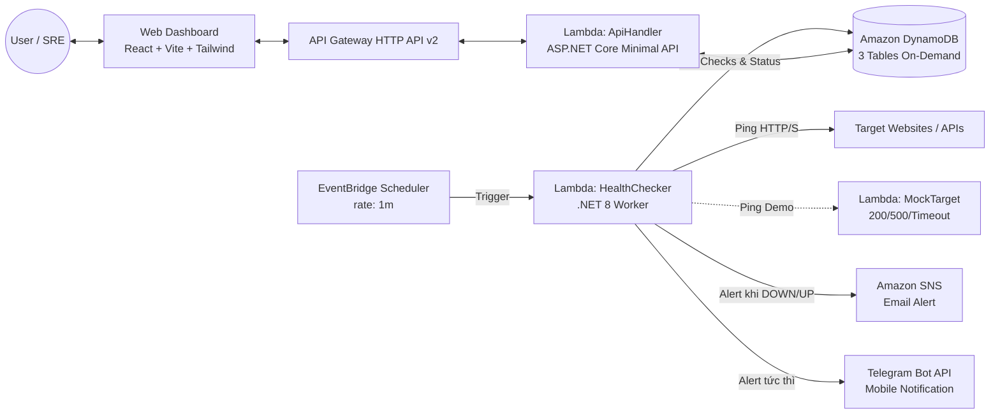

# CloudPulse — Website & API Health Monitoring on AWS

[](https://aws.amazon.com/)
[](https://dotnet.microsoft.com/)
[](https://vitejs.dev/)
[](https://aws.amazon.com/serverless/sam/)
[](LICENSE)

> **CloudPulse** là hệ thống giám sát tính khả dụng (Uptime) và hiệu năng (Response Time) của Website/API dựa trên nền tảng **AWS Serverless & Event-Driven**. Hệ thống tự động kiểm tra định kỳ, phát hiện lỗi mạng/sự cố máy chủ, cảnh báo tức thời đa kênh (**Email qua Amazon SNS** & **Telegram Bot**), đồng thời cung cấp Dashboard trực quan cho người quản trị với chi phí vận hành tiệm cận **$0 (100% AWS Free Tier)**.

---

## 📑 Mục lục Tài liệu Dự án

Tài liệu dự án được tổ chức bài bản theo chuẩn kỹ nghệ phần mềm tại thư mục `docs/`:

1. 📖 **[Đặc tả Yêu cầu Hệ thống (Requirements)](./docs/requirements.md)**: Danh sách đầy đủ yêu cầu chức năng (MVP), yêu cầu phi chức năng (NFR) và phạm vi ngoài dự án (Out of Scope).
2. 🔄 **[Các Luồng Sử dụng Chính (Use Cases)](./docs/use-cases.md)**: Kịch bản và sơ đồ tuần tự (Sequence Diagrams) cho 7 luồng nghiệp vụ cốt lõi.
3. ✅ **[Tiêu chí Nghiệm thu Chi tiết (Acceptance Criteria)](./docs/acceptance-criteria.md)**: Bộ điều kiện nghiệm thu theo chuẩn Given-When-Then cho từng tính năng.
4. 📄 **[Tài liệu Tổng quan & Product Discovery](./CloudPulse_Overview1.md)**: Bản phân tích bài toán thực tế, đối tượng sử dụng, và giá trị khác biệt (UVP).

---

## 🏛️ Kiến trúc Tổng thể (High-Level Architecture)



---

## ⚡ Các Tính năng Nổi bật (MVP Core)

* **Giám sát Tự động Định kỳ**: Tự động kiểm tra HTTP/HTTPS mỗi 1 phút mà không cần máy chủ chạy ngầm.
* **Cơ chế Chống Báo Động Giả (Smart State Machine)**: Ngưỡng **2 lần lỗi liên tiếp** mới xác nhận `DOWN`, tránh spam email khi mạng chập chờn nhất thời.
* **Cảnh báo Đa kênh Tức thời**: Gửi thông báo đến cả **Email (SNS)** và **Telegram Bot** trong vòng $\le 5$ giây sau khi xác nhận sự cố; tự động gửi thông báo khôi phục khi website `UP` trở lại.
* **Nút "Check Now"**: Kích hoạt kiểm tra ngay lập tức trên Dashboard trong vòng 1-2 giây phục vụ việc chấm thi demo.
* **Dịch vụ MockTarget Nội bộ**: Hàm Lambda hỗ trợ điều khiển tạo lỗi chủ động (`?status=200`, `?status=500`, `?delay=7000`) để demo không phụ thuộc vào Internet bên ngoài.
* **Bảo vệ Chống SSRF**: Tự động chặn các URL trỏ về IP nội bộ hoặc AWS Instance Metadata (`169.254.169.254`).
* **Tự Động Dọn Dẹp (Auto-Cleanup)**: Bản ghi kiểm tra cũ tự động xóa sau 7 ngày bằng **DynamoDB TTL**, không làm phình dung lượng lưu trữ.

---

## 🚀 Hướng dẫn Chạy Thử nghiệm Sơ bộ

### 1. Yêu cầu Môi trường
* [.NET 8 SDK](https://dotnet.microsoft.com/download/dotnet/8.0)
* [Node.js (>= 18)](https://nodejs.org/) & `npm`
* [AWS CLI](https://aws.amazon.com/cli/) & [AWS SAM CLI](https://docs.aws.amazon.com/serverless-application-model/latest/developerguide/install-sam-cli.html)

### 2. Chạy Frontend cục bộ (Local Development)
```bash
cd frontend
npm install
npm run dev
```
Truy cập giao diện tại: `http://localhost:3000` (đã tích hợp mock data fallback để test UI ngay lập tức).

### 3. Triển khai toàn bộ Hạ tầng lên AWS
```bash
# 1. Build mã nguồn và đóng gói Lambda
sam build

# 2. Triển khai lên tài khoản AWS cá nhân
sam deploy --guided
```

### 4. Dọn dẹp tài nguyên sau khi kết thúc môn học
```bash
sam delete --stack-name cloudpulse-app
```

---

## 👥 Nhóm Thực hiện
* **Môn học**: Điện toán đám mây (Cloud Computing)
* **Quy mô**: 5 thành viên | Thời gian hoàn thiện: 4 tuần

