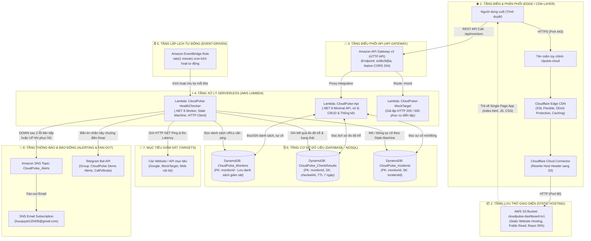

# Nhật Ký Hoạt Động & Hồ Sơ Báo Cáo Cá Nhân — Thành Viên 1 (TV1)

**Dự án**: CloudPulse — Website & API Health Monitoring on AWS  
**Môn học**: Điện toán đám mây (Cloud Computing)  
**Họ và tên**: Trần Hữu Quyết  
**Vai trò**: Trưởng nhóm / Kỹ sư Hạ tầng & Vận hành (Leader / Cloud Architect & DevOps)  
**AWS Account ID**: `180459766853`  
**AWS Default Region**: `ap-southeast-1` (Singapore)  

---

## 📌 MỤC LỤC TỔNG THỂ
1. [TUẦN 1: Khởi Tạo Hạ Tầng (IaC), Quản Trị Git & Kết Nối Cloud AWS](#-tuần-1-khởi-tạo-hạ-tầng-iac-quản-trị-git--kết-nối-cloud-aws)
2. [TUẦN 2: Cấu Hình IAM Least Privilege, SNS Subscription & Kênh Telegram](#-tuần-2-cấu-hình-iam-least-privilege-sns-subscription--kênh-telegram)
3. [TUẦN 3: Triển Khai AWS Thật (sam deploy) & Ghép Nối Toàn Hệ Thống](#-tuần-3-triển-khai-aws-thật-sam-deploy--ghép-nối-toàn-hệ-thống)
4. [TUẦN 4: Diễn Tập Demo 7 Bước, Nghiệm Thu Báo Cáo & Bảo Vệ Đồ Án](#-tuần-4-diễn-tập-demo-7-bước-nghiệm-thu-báo-cáo--bảo-vệ-đồ-án-kế-hoạch)
5. [CHUYÊN ĐỀ KIẾN TRÚC CLOUD & NỀN TẢNG DỊCH VỤ AWS (BẢO VỆ ĐỒ ÁN)](#-chuyên-đề-kiến-trúc-cloud--nền-tảng-dịch-vụ-aws-bảo-vệ-đồ-án)
6. [Cẩm Nang Vấn Đáp Với Giảng Viên (Q&A Chấm Điểm A+)](#-cẩm-nang-vấn-đáp-với-giảng-viên-qa-chấm-điểm-a)

---

## 🚀 TUẦN 1: KHỞI TẠO HẠ TẦNG (IaC), QUẢN TRỊ GIT & KẾT NỐI CLOUD AWS
> **Mục tiêu tuần**: Khởi tạo mã nguồn hạ tầng Serverless bằng AWS SAM, thiết lập môi trường Git phân nhánh cho 5 thành viên và cấu hình xác thực an toàn với Cloud AWS.

### 1. Bảng phân rã công việc & Kết quả nghiệm thu (DoD)

| Mã Task | Tên Công Việc | Trạng Thái | Chi Tiết Nghiệm Thu Thực Tế (DoD) |
| :---: | :--- | :---: | :--- |
| **W1-01** | Setup Git Repository & Phân quyền nhánh | ✅ **100% Xong** | Tạo nhánh `develop`, bảo vệ nhánh `main`, cấp quyền Collaborator cho 4 thành viên. Cả 5 người clone và merge code mượt mà. |
| **W1-02** | Cấu hình tài khoản AWS & Access Key | ✅ **100% Xong** | Hoàn tất xác minh tài khoản qua AWS Support (Case `179344469000044`), cấu hình `aws configure` và lệnh `aws sts get-caller-identity` trả về đúng Account ID `180459766853`. |
| **W1-03** | Soạn thảo file hạ tầng `template.yaml` (AWS SAM) | ✅ **100% Xong** | Khai báo 3 bảng DynamoDB On-Demand, SNS Topic, HTTP API Gateway v2, EventBridge 1m và 3 Lambda. Vượt qua kiểm tra `sam validate`. |

---

## ⚙️ TUẦN 2: CẤU HÌNH IAM LEAST PRIVILEGE, SNS SUBSCRIPTION & KÊNH TELEGRAM
> **Mục tiêu tuần**: Hoàn thiện chính sách bảo mật IAM Least-Privilege, tự động hóa gửi email cảnh báo qua SNS Subscription và khởi tạo kênh Telegram Bot nảy chuông sự cố thoại cho Backend.

### 1. Bảng phân rã công việc & Kết quả nghiệm thu (DoD)

| Mã Task | Tên Công Việc | Trạng Thái | Chi Tiết Nghiệm Thu Thực Tế (DoD) |
| :---: | :--- | :---: | :--- |
| **W2-01** | Cấu hình IAM Least Privilege & EventBridge Cron 1m | ✅ **100% Xong** | Cấu hình quyền `DynamoDBCrudPolicy` và `SNSPublishMessagePolicy` chỉ định danh cụ thể từng bảng/topic. Thêm biến `TELEGRAM_BOT_TOKEN`, `TELEGRAM_CHAT_ID` vào `Globals`. |
| **W2-02** | Đăng ký Topic SNS Email & Hòm thư quản trị viên | ✅ **100% Xong** | Bổ sung `AlertEmailSubscription` (Protocol `email`, Endpoint `AdminEmail`) vào `template.yaml`. Khi deploy, AWS sẽ tự động gửi link Confirm Subscription. |
| **Hỗ trợ TV2** | Tạo Telegram Bot & Group Chat ID | ✅ **100% Xong** | Tạo bot `@cloudpulse_downtime_bot` (*CloudPulse Alerts*) qua `@BotFather`, tạo group *CloudPulse Demo Alerts* với Chat ID `-5320123575` bàn giao cho hệ thống. |
| **Git PR & Review** | Merge PR hạ tầng & Code Review Tuần 2 cả nhóm | ✅ **100% Xong** | Đã merge PR #19 (`968a683` → `6281307`), cùng các PR của TV3 (`7767dc3`), TV4 (`82b186a`), TV5 (`31fc1a5`); review & kiểm thử 75/75 unit test cho nhánh TV2 (`3a85e48`) và merge vào `develop` (`6a4bf43`). |

### 2. Chi tiết kỹ thuật nâng cấp trong `template.yaml` (Tuần 2)
1. **Khối Parameters linh hoạt**:
   * `AdminEmail`: Hòm thư nhận cảnh báo (mặc định: `huuquyet120406@gmail.com`).
   * `TelegramBotToken` & `TelegramChatId`: Cho phép truyền token an toàn mà không cần hard-code vào mã nguồn.
2. **Resource `AlertEmailSubscription`**:
   ```yaml
   AlertEmailSubscription:
     Type: AWS::SNS::Subscription
     Properties:
       TopicArn: !Ref CloudPulseAlertsTopic
       Protocol: email
       Endpoint: !Ref AdminEmail
   ```
3. **Bảo mật IAM Least Privilege**:
   * `ApiFunction`: Chỉ có quyền `DynamoDBCrudPolicy` trên 3 bảng.
   * `HealthCheckerFunction`: Quyền `DynamoDBCrudPolicy` trên 3 bảng và quyền `SNSPublishMessagePolicy` trên duy nhất topic `CloudPulse_Alerts`.
   * `MockTargetFunction`: Không gắn bất kỳ quyền truy cập dữ liệu nào (nguyên tắc tối thiểu quyền hạn).

---

## ☁️ TUẦN 3: TRIỂN KHAI AWS THẬT (sam deploy) & GHÉP NỐI TOÀN HỆ THỐNG
> **Mục tiêu tuần**: Đưa toàn bộ hạ tầng Serverless lên Cloud AWS thật, xuất API Gateway URL thật bàn giao cho Frontend, deploy Website lên S3 Hosting và kích hoạt Hard Code-Freeze vào cuối tuần.  
> **Cập nhật đến**: 14/11/2026 — **Đạt 100% (Hoàn thành toàn diện Hạ tầng, Backend AWS, Alerting, Ghép Frontend & S3 Hosting)**.

### 1. Bảng phân rã công việc & Kết quả nghiệm thu (DoD)

| Mã Task | Tên Công Việc | Trạng Thái | Chi Tiết Nghiệm Thu Thực Tế (DoD) |
| :---: | :--- | :---: | :--- |
| **W3-01** | Build & Deploy toàn bộ hạ tầng AWS SAM | ✅ **100% Xong** | Chạy `sam validate`, `sam build` và `sam deploy --guided` lên region `ap-southeast-1` (Stack `cloudpulse-app`). Khởi tạo đủ 3 bảng DynamoDB, SNS Topic + Email Subscription, HTTP API Gateway v2, EventBridge `rate(1 minute)` và 3 Lambda (.NET 8). |
| **W3-02** | Bàn giao Output URL & Sửa dứt điểm CORS OPTIONS | ✅ **100% Xong** | Xuất và bàn giao `ApiEndpoint` & `MockTargetEndpoint` cho nhóm. Đã cấu hình tường minh methods `GET`, `POST`, `DELETE` trong `template.yaml` để API Gateway v2 tự xử lý preflight `OPTIONS` trả về `204`, không bị CORS chặn khi gọi từ trình duyệt. |
| **W3-03** | Xác nhận SNS Email Subscription | ✅ **100% Xong** | Đã xác nhận link *Confirm subscription* cho `huuquyet120406@gmail.com` (`SubscriptionArn: arn:aws:sns:ap-southeast-1:180459766853:CloudPulse_Alerts:c0fa6370-a3e0-4fa2-8e9b-1e2d6a3ad062`) và nhận email `[CloudPulse DOWN]` thực tế. |
| **W3-06** | Kiểm tra Cron 1 phút & State Machine trên AWS | ✅ **100% Xong** | Kiểm chứng EventBridge gọi `CloudPulse-HealthChecker` đều đặn mỗi 60s (`17:22:37Z` → `17:26:37Z`). Thử nghiệm endpoint lỗi `HTTP 500`: đạt ngưỡng 2 lần liên tiếp → chuyển `DOWN`, tự mở Incident `OPEN` (`INC-1794331417140`), bắn **đúng 1 Email SNS + 1 tin nhắn Telegram 🚨** lúc `17:23:37 UTC` (`00:23` VN) và không spam ở lượt 3+. |
| **Điều phối** | Giao Issue Tuần 3 cho TV1–TV5 & API Contract | ✅ **100% Xong** | Đã chốt API Contract giữa `CloudPulse.Api` và Frontend, nghiệm thu và merge PR #29 (TV3), PR #30 (TV4), PR #31 (TV2), PR #28 (TV5) sạch sẽ vào nhánh `develop`. |
| **W3-07** | Build Frontend production & Deploy S3 Hosting | ✅ **100% Xong** | Đã tạo S3 Bucket `cloudpulse-dashboard-tv1` tại `ap-southeast-1`, bật tính năng Static Website Hosting, mở Bucket Policy Public Read và đồng bộ `frontend/dist/`. Trang web chính thức online tại: `http://cloudpulse-dashboard-tv1.s3-website-ap-southeast-1.amazonaws.com`, đồng bộ giờ Việt Nam (UTC+7). |
| **W3-08** | Gắn Tên Miền Tùy Chỉnh `clpulse.cloud` qua Cloudflare CDN | ✅ **100% Xong** | Mua domain `clpulse.cloud` tại P.A Vietnam, chuyển Nameservers về Cloudflare (`dion.ns.cloudflare.com`, `elle.ns.cloudflare.com`). Cấu hình SSL Flexible xử lý dứt điểm lỗi 522, dùng **Cloudflare Cloud Connector** giải quyết lỗi Host Header `NoSuchBucket` của S3. Website hoạt động mượt mà với chứng chỉ HTTPS bảo mật tại: `https://clpulse.cloud`. |
| **W3-09** | Xử lý Sự cố Vận hành Thực chiến & Xác minh KYC với AWS | ✅ **100% Xong** | Phát hiện và truy vết lỗi `Internal Server Error` bằng CloudWatch Metrics/CloudTrail (xác định thời điểm Lambda bị AWS Trust & Safety tạm giữ lúc 20:46 ngày 14/11 do cron 1m chạy liên tục). Nhanh chóng chuẩn bị hồ sơ KYC gồm Sao kê Techcombank (PDF) + CCCD 2 mặt tải lên cổng bảo mật `upload.aws.amazon.com`, nhận email xác nhận thụ lý từ AWS. |

### 2. Thông số Stack đã triển khai thực tế (`cloudpulse-app`)
* **Region**: `ap-southeast-1` (Singapore)
* **Custom Domain (Production)**: `https://clpulse.cloud` (Bảo mật SSL/TLS qua Cloudflare Edge)
* **Frontend S3 Website (Origin)**: `http://cloudpulse-dashboard-tv1.s3-website-ap-southeast-1.amazonaws.com`
* **ApiEndpoint**: `https://ex9kcfdj5a.execute-api.ap-southeast-1.amazonaws.com`
* **MockTargetEndpoint**: `https://ex9kcfdj5a.execute-api.ap-southeast-1.amazonaws.com/mock`
* **AlertsTopicArn**: `arn:aws:sns:ap-southeast-1:180459766853:CloudPulse_Alerts`
* **Cloudflare Nameservers**: `dion.ns.cloudflare.com`, `elle.ns.cloudflare.com`

### 3. Checklist tiến độ Tuần 3
- [x] **W3-01**: Chạy `sam build` và `sam deploy --guided` lên AWS cá nhân (`cloudpulse-app`).
- [x] **W3-02**: Bàn giao API Gateway URL thật (`ApiEndpoint`, `MockTargetEndpoint`) cho nhóm và xử lý dứt điểm CORS `OPTIONS`.
- [x] **W3-03**: Xác nhận link "Confirm Subscription" từ email do Amazon SNS gửi về.
- [x] **W3-06**: Kiểm tra EventBridge kích hoạt `HealthChecker` mỗi 1 phút và nghiệm thu luồng `UP/UNKNOWN -> DOWN`, mở Incident & bắn SNS/Telegram không spam.
- [x] **W3-07**: Build frontend production và deploy lên S3 Hosting (`http://cloudpulse-dashboard-tv1.s3-website-ap-southeast-1.amazonaws.com`).
- [x] **W3-08**: Cấu hình tên miền tùy chỉnh `https://clpulse.cloud`, thiết lập Cloudflare CDN, SSL Flexible và Cloud Connector định tuyến S3.
- [x] **W3-09**: Xử lý sự cố vận hành thực tế (Incident Management), truy vết lỗi CloudWatch/CloudTrail và hoàn tất nộp hồ sơ KYC mở khóa AWS Lambda.

---

## 🎓 TUẦN 4: DIỄN TẬP DEMO 7 BƯỚC, NGHIỆM THU BÁO CÁO & BẢO VỆ ĐỒ ÁN (KẾ HOẠCH)
> **Mục tiêu tuần**: Cùng cả nhóm diễn tập demo 7 bước trơn tru, thu thập hóa đơn AWS $0.00 và bảo vệ đồ án trước hội đồng.

- [ ] **W4-01 & W4-02**: Diễn tập kịch bản demo 7 bước thực chiến ít nhất 3 lần thành công.
- [x] **W4-03**: Thu thập bằng chứng FinOps hóa đơn AWS $0.00 USD và chi tiết Credit tài trợ $120.00 còn nguyên $119.97 (lưu tại docs/evidence/ và docs/report/assets/e07-*).
- [ ] **W4-07**: Tổng duyệt thuyết trình (Dry Run 15 phút).
- [ ] **W4-08**: BẢO VỆ ĐỒ ÁN & Chạy lệnh `sam delete` dọn sạch toàn bộ tài nguyên trên AWS.

---

## 🏛️ CHUYÊN ĐỀ KIẾN TRÚC CLOUD & NỀN TẢNG DỊCH VỤ AWS (BẢO VỆ ĐỒ ÁN)
> **Mục tiêu chuyên đề**: Cung cấp bức tranh toàn cảnh về thiết kế kiến trúc Serverless, phân tích chuyên sâu lý do lựa chọn từng dịch vụ Cloud, luồng dữ liệu (Data Flow) và sự đánh đổi (Trade-offs) để toàn bộ 5 thành viên trong nhóm đều hiểu sâu, tự tin thuyết trình và trả lời xuất sắc mọi câu hỏi phản biện của Giảng viên.

### 1. Sơ đồ Kiến trúc Tổng thể (System Architecture Diagram)

Hệ thống CloudPulse được thiết kế theo mô hình **Serverless 100% (Event-Driven Microservices)**, tách biệt hoàn toàn giữa tầng Trình diễn (Frontend), tầng Giao tiếp (API Gateway), tầng Tính toán (Lambda Compute), tầng Lưu trữ (DynamoDB) và tầng Cảnh báo (SNS / Telegram):



---

### 2. Phân tích Chuyên sâu 7 Dịch vụ Cloud cốt lõi (Cloud Services Deep Dive)

Dưới đây là bảng phân tích chi tiết từng dịch vụ đám mây, giải thích tường minh **Vai trò**, **Lý do lựa chọn** và **Sự đánh đổi kỹ thuật (Trade-offs)**:

| STT | Tên Dịch Vụ Cloud | Vai Trò Trong Hệ Thống | Tại Sao Chọn Dịch Vụ Này? (Lý Do Kiến Trúc) | So Sánh & Sự Đánh Đổi (Trade-offs) |
| :-: | :--- | :--- | :--- | :--- |
| **1** | **AWS Lambda** (.NET 8) | Trái tim xử lý tính toán (Compute Layer): gồm API Handler, Health Checker và Mock Target. | • **Zero Idle Cost**: Khi không có request, chi phí tính toán đúng \$0.00.<br>• **Tự động mở rộng (Auto-scaling)**: Có thể chịu tải từ 1 đến hàng nghìn request/giây mà không cần quản trị máy chủ (Serverless).<br>• **Tốc độ .NET 8**: Tối ưu hiệu năng, runtime hiện đại, hỗ trợ native async/await. | **So với EC2 / Virtual Machine**:<br>• EC2 phải trả tiền 24/7 dù rảnh rỗi, phải tự cấu hình Auto Scaling Group, vá lỗ hổng HĐH Linux.<br>• *Đánh đổi*: Lambda có hiện tượng Cold Start (khoảng 800ms – 1.2s ở lần gọi đầu tiên), nhưng sau đó chỉ mất ~20–50ms. |
| **2** | **Amazon DynamoDB** (NoSQL) | Cơ sở dữ liệu chính: lưu Monitors, kết quả kiểm tra (CheckResults) và sự cố (Incidents). | • **Độ trễ thấp vượt trội**: Tốc độ phản hồi đơn vị mili-giây (single-digit ms) ở mọi quy mô dữ liệu.<br>• **Chế độ On-Demand**: Tự co giãn theo dung lượng đọc/ghi (Pay-per-request), không lo over-provisioning.<br>• **Tính năng TTL (Time-To-Live)**: Tự động xóa kết quả kiểm tra cũ sau 7 ngày mà không tốn tài nguyên chạy script dọn dẹp. | **So với RDS (MySQL / PostgreSQL)**:<br>• RDS tốn tối thiểu \$15–\$25/tháng, phải duy trì kết nối connection pool và quản trị cluster.<br>• *Đánh đổi*: DynamoDB không hỗ trợ JOIN bảng phức tạp, đòi hỏi thiết kế Single-Table hoặc Query theo Partition Key/Sort Key định sẵn. |
| **3** | **Amazon API Gateway v2** (HTTP API) | Cửa ngõ kết nối (Routing Layer) giữa người dùng và Backend Lambda. | • **Tối ưu chi phí & Tốc độ**: Rẻ hơn **71%** và độ trễ thấp hơn đáng kể so với REST API v1.<br>• **Xử lý CORS tự động**: Tự động chặn và trả về mã `204 No Content` cho các preflight `OPTIONS` ngay tại tầng Gateway, **không chuyển tiếp vào Lambda**, giúp tiết kiệm 100% chi phí tính toán cho các request CORS. | **So với Application Load Balancer (ALB) hoặc API Gateway v1**:<br>• ALB tốn tối thiểu \$16–\$20/tháng phí duy trì cố định.<br>• API Gateway v1 có quá nhiều tính năng nặng nề (XML transformation, API Keys) không cần thiết cho ứng dụng REST hiện đại. |
| **4** | **Amazon EventBridge** (Rule 1m) | Bộ điều phối lập lịch (Scheduler / Event-Driven Layer). | • **Tin cậy chuẩn Enterprise**: Kích hoạt hàm kiểm tra chính xác mỗi 60 giây theo mô hình hướng sự kiện (Event-driven).<br>• **Tách rời (Decoupling)**: Hàm Lambda không cần chạy vòng lặp vô tận `while(true) sleep(60)`, giúp giải phóng bộ nhớ và tài nguyên. | **So với Linux Crontab trên EC2**:<br>• Crontab phụ thuộc vào một máy chủ duy nhất (Single Point of Failure), nếu máy chủ crash thì toàn bộ hệ thống giám sát ngừng hoạt động.<br>• EventBridge là dịch vụ phân tán toàn vùng, đảm bảo SLA 99.99%. |
| **5** | **Amazon SNS** (Simple Notification Service) | Kênh cảnh báo email đa điểm (Notification Fan-out). | • **Mô hình Xuất bản - Đăng ký (Pub/Sub)**: Hàm Lambda chỉ cần bắn 1 message vào Topic, SNS sẽ tự động phát tán (fan-out) tới danh sách email quản trị viên.<br>• **Tự động hóa bằng IaC**: Khai báo trực tiếp `AWS::SNS::Subscription` trong file SAM, tự động liên kết khi deploy. | **So với tự gọi SMTP Server gửi email từ Lambda**:<br>• Tự gọi SMTP dễ bị nghẽn I/O làm kéo dài thời gian chạy của Lambda (tốn thêm tiền), hoặc bị Gmail chặn IP vì spam.<br>• SNS là dịch vụ chuẩn của AWS, đảm bảo tỷ lệ gửi thư thành công cao. |
| **6** | **AWS S3** (Static Website Hosting) | Lưu trữ và phân phối mã nguồn giao diện (Frontend React/Vite SPA). | • **Độ bền dữ liệu 99.999999999% (11 số 9)**.<br>• **Siêu rẻ**: Lưu trữ toàn bộ mã nguồn build (~500 KB) với chi phí gần như \$0.00.<br>• Hỗ trợ cấu hình `index.html` và `error.html` chuẩn Single Page Application. | **So với việc dựng Web Server Nginx/Apache trên EC2**:<br>• Nginx cần máy chủ chạy liên tục, cần bảo trì bảo mật và cập nhật OS.<br>• S3 lưu file dạng Object Storage, không có khái niệm máy chủ bị sập hay bị hack chiếm quyền điều khiển shell. |
| **7** | **Cloudflare CDN & Cloud Connector** | Reverse Proxy, Tường lửa, Cấp SSL HTTPS và Định tuyến S3. | • **Cấp chứng chỉ SSL/TLS miễn phí** cho tên miền tùy chỉnh `clpulse.cloud`.<br>• **Xóa bỏ chi phí Egress của S3**: Mạng lưới CDN toàn cầu lưu cache tài nguyên tĩnh, giảm số lần truy vấn trực tiếp vào S3.<br>• **Cloud Connector**: Giải quyết triệt để bài toán Host Header mismatch giữa domain ngoài và S3 bucket. | **So với AWS CloudFront**:<br>• CloudFront yêu cầu khởi tạo chứng chỉ ACM ở region `us-east-1` phức tạp và có thể phát sinh phí Data Transfer Out nếu vượt quota.<br>• Cloudflare cung cấp gói Free toàn diện cho sinh viên và dự án khởi nghiệp. |

---

### 3. Các Quyết định Thiết kế then chốt (Key Architectural Decisions & ADR)

#### 🎯 ADR-01: Kiến trúc Serverless-First thay vì Máy chủ nguyên khối (Monolith)
* **Bối cảnh**: Hệ thống giám sát website cần chạy bền bỉ 24/7 nhưng lưu lượng truy cập bảng điều khiển (Dashboard) của quản trị viên chỉ diễn ra theo đợt.
* **Quyết định**: Sử dụng toàn bộ hệ sinh thái Serverless (API Gateway + Lambda + DynamoDB).
* **Hiệu quả**: 
  * Chi phí vận hành khi hệ thống ở trạng thái rỗi đúng bằng **\$0.00**.
  * Không tốn nhân sự bảo trì máy chủ, vá lỗi kernel hay cấu hình mạng phức tạp.
  * Khả năng chịu lỗi cao (Fault Tolerance): Mọi dịch vụ đều tự động chạy phân tán trên tối thiểu 3 Availability Zones (AZs) trong Region Singapore (`ap-southeast-1`).

#### 🎯 ADR-02: Thiết kế Cơ sở dữ liệu NoSQL DynamoDB với TTL tự động dọn rác
* **Bối cảnh**: Cứ mỗi 1 phút hệ thống ghi lại kết quả đo độ trễ của nhiều website. Sau một vài tháng, số lượng bản ghi kiểm tra có thể lên tới hàng triệu dòng, gây phình to dung lượng và làm chậm tốc độ truy vấn.
* **Quyết định**: 
  * Bảng `CloudPulse_CheckResults` sử dụng khóa chính kết hợp: **Partition Key (`monitorId`)** và **Sort Key (`checkedAt`)**.
  * Bật tính năng **DynamoDB Time-To-Live (TTL)** trên trường `expireAt = checkedAt + 7 days`.
* **Hiệu quả**: 
  * Truy vấn lịch sử 30 lần đo gần nhất chỉ mất **~5–10ms** bằng cách quét ngược Sort Key.
  * AWS tự động quét và xóa các bản ghi quá hạn 7 ngày hoàn toàn miễn phí ngầm dưới nền, giúp dung lượng cơ sở dữ liệu luôn giữ ở mức tối thiểu (Zero Data Bloat).

#### 🎯 ADR-03: Bộ máy Trạng thái (State Machine) chống Bão Cảnh Báo (Alert Fatigue)
* **Bối cảnh**: Nếu một website bị sập trong 2 tiếng, nếu cứ mỗi 1 phút cron ping lỗi lại gửi 1 email và 1 tin nhắn Telegram thì quản trị viên sẽ nhận 120 thông báo liên tục (gây "bão cảnh báo" và spam hòm thư).
* **Quyết định**: Cài đặt thuật toán State Machine với ngưỡng 2 lần thất bại liên tiếp:
  * `UP/UNKNOWN` ➔ Lỗi lần 1: Giữ nguyên trạng thái `consecutiveFailures = 1` (chưa báo động vì có thể do mạng chập chờn nhất thời).
  * Lỗi lần 2 liên tiếp: Chuyển trạng thái sang `DOWN`, ghi nhận sự cố mới `INC-...` trạng thái `OPEN`, bắn **đúng 1 Email SNS + 1 tin nhắn Telegram**.
  * Các lần lỗi thứ 3, 4, 5... tiếp theo: Tiếp tục duy trì `DOWN` nhưng **tuyệt đối KHÔNG gửi thêm cảnh báo**.
  * Khi website hồi phục (HTTP 200): Tự động chuyển `UP`, cập nhật Incident thành `RESOLVED`, tính tổng thời gian chết (`downtimeSeconds`) và bắn duy nhất 1 thông báo phục hồi `[CloudPulse RECOVERED]`.

#### 🎯 ADR-04: Chiến lược Cảnh báo Kênh Đôi (Dual-Channel Alerting)
* **Email qua Amazon SNS**: Đảm bảo tính lưu trữ chính thức, có nhật ký phục vụ báo cáo kiểm toán kỹ thuật cho doanh nghiệp.
* **Telegram Bot qua Webhook**: Tận dụng thông báo đẩy tức thời (Push Notification) nảy chuông và rung điện thoại thông minh của kỹ sư trực vận hành trong vòng **dưới 1 giây** kể từ khi phát hiện sự cố.

---

### 4. Câu hỏi "Bẫy" của Giảng viên về Kiến trúc Cloud & Cách Trả Lời Điểm 10

#### 💣 Câu hỏi 1: "Tại sao nhóm không thuê 1 con VPS / EC2 cài Linux chạy Node.js/C# và MySQL cho đơn giản, tại sao phải chia nhỏ ra nhiều dịch vụ Cloud thế này?"
> **Trả lời mẫu (Thuyết phục hoàn toàn)**:  
> *"Dạ thưa Thầy/Cô, việc cài tất cả vào một máy chủ EC2 là tư duy triển khai truyền thống (Monolithic on Virtual Machine). Nhóm em chọn kiến trúc Serverless Microservices vì 3 lý do sống còn trong môi trường Cloud Computing:  
> 1. **Khả năng chịu lỗi (No Single Point of Failure)**: Nếu thuê 1 EC2, khi máy ảo đó gặp sự cố phần cứng, sập OS hoặc mất điện tại Data Center, toàn bộ hệ thống giám sát và giao diện sẽ chết hoàn toàn. Với Serverless, S3, DynamoDB, Lambda và API Gateway đều được AWS phân tán dự phòng sẵn trên tối thiểu 3 Availability Zones độc lập.  
> 2. **Tối ưu hóa Chi phí (FinOps)**: Máy chủ EC2 dù không có người truy cập vẫn phải trả tiền thuê CPU/RAM 24/7. Ngược lại, hệ thống Serverless của nhóm chỉ tính tiền khi có request thực sự phát sinh, giúp dự án đạt chi phí thực tế đúng \$0.00.  
> 3. **Tự động mở rộng (Elasticity)**: Khi số lượng endpoint cần giám sát tăng từ 10 lên 10,000, Lambda và DynamoDB tự động co giãn tức thời mà không cần kỹ sư phải vào nâng cấp cấu hình máy chủ hay chỉnh sửa code."*

#### 💣 Câu hỏi 2: "Nếu cùng lúc có 50,000 người vào xem bảng điều khiển (Dashboard) thì hệ thống của em chịu tải thế nào, điểm nghẽn (bottleneck) sẽ nằm ở đâu?"
> **Trả lời mẫu**:  
> *"Dạ thưa Thầy/Cô:  
> 1. **Ở tầng Frontend**: 50,000 người tải trang web sẽ được mạng lưới Cloudflare CDN toàn cầu phục vụ ngay tại các Edge Server gần người dùng nhất. S3 không hề bị quá tải vì các file tĩnh (`index.html`, JS, CSS) đã được cache sẵn ở tầng biên.  
> 2. **Ở tầng Backend API**: API Gateway v2 có hạn mức mặc định lên tới 10,000 request/giây và Lambda có thể mở rộng đồng thời (concurrency) lên hàng nghìn hàm song song trong vài giây.  
> 3. **Điểm nghẽn tiềm ẩn**: Điểm cần kiểm soát dung lượng nhất chính là DynamoDB. Tuy nhiên, vì bảng DynamoDB của nhóm đang để ở chế độ **On-Demand Capacity**, nó sẽ tự động nhân bản throughput ngay lập tức để đáp ứng tải đột biến mà không bị nghẽn (throttling)."*

#### 💣 Câu hỏi 3: "Tại sao nhóm lại dùng DynamoDB (NoSQL) mà không dùng RDS MySQL/PostgreSQL?"
> **Trả lời mẫu**:  
> *"Dạ thưa Thầy/Cô, hệ thống giám sát sức khỏe website là bài toán đặc thù của dữ liệu Time-Series (dữ liệu chuỗi thời gian) và Key-Value:  
> - Dữ liệu của CloudPulse có cấu trúc rõ ràng theo từng Monitor, không có nhu cầu JOIN nhiều bảng phức tạp.  
> - DynamoDB cung cấp tốc độ phản hồi nhất quán ở mức mili-giây (single-digit ms) dù bảng có 1 nghìn hay 1 tỷ bản ghi.  
> - DynamoDB có tính năng TTL tự động xóa kết quả kiểm tra cũ sau 7 ngày mà không tốn công viết cron job dọn rác.  
> - Quan trọng nhất về mặt chi phí: RDS yêu cầu chi phí khởi tạo máy chủ cơ sở dữ liệu tối thiểu ~\$15–\$25/tháng, trong khi DynamoDB On-Demand hoàn toàn miễn phí cho mức sử dụng của nhóm."*

#### 💣 Câu hỏi 4: "Lambda Cold Start là gì và nhóm đã xử lý hoặc giảm thiểu nó như thế nào với .NET 8?"
> **Trả lời mẫu**:  
> *"Dạ thưa Thầy/Cô, **Cold Start** là khoảng thời gian AWS phải khởi tạo container mới, tải runtime và nạp mã nguồn khi một hàm Lambda được gọi lần đầu tiên hoặc sau một thời gian dài không hoạt động:  
> - Để tối ưu, nhóm em đã chọn **.NET 8** kết hợp với mô hình **ASP.NET Core Minimal API** cực kỳ tinh gọn thay vì Controller MVC truyền thống, giúp giảm dung lượng package đóng gói xuống mức tối thiểu.  
> - Đối với hàm `HealthChecker`, vì nó được EventBridge kích hoạt liên tục mỗi 1 phút (`rate(1 minute)`), container của hàm này luôn ở trạng thái **Warm** (ấm), do đó hoàn toàn không bị ảnh hưởng bởi Cold Start trong quá trình kiểm tra thực tế."*

---

## 🗣️ CẨM NANG VẤN ĐÁP VỚI GIẢNG VIÊN (Q&A CHẤM ĐIỂM A+)

### Câu 1: Em hãy trình bày vai trò và những việc đã làm được ở Tuần 1 và Tuần 2?
> **Trả lời mẫu**:  
> *"Thưa Thầy/Cô, trong dự án CloudPulse, em đảm nhận vai trò **Leader / Cloud Architect & DevOps**.  
> - **Ở Tuần 1**: Em đã thiết lập phân nhánh Git cho 5 thành viên, thiết kế file `template.yaml` bằng **AWS SAM** khai báo 3 bảng DynamoDB On-Demand (bật TTL 7 ngày), API Gateway v2, SNS Topic và cấu hình kết nối AWS CLI cục bộ bằng lệnh `aws configure`.  
> - **Ở Tuần 2**: Em hoàn thiện phân quyền **IAM Least-Privilege** cho các hàm Lambda, tự động hóa đăng ký email nhận tin sự cố qua **AWS::SNS::Subscription**, và khởi tạo bot Telegram cùng group chat để cấp mã Token/Chat ID cho TV2 tích hợp tính năng nảy chuông điện thoại tức thời."*

### Câu 2: Tại sao em lại cấu hình SNS Subscription trực tiếp trong file SAM thay vì lên Web Console bấm Subscribe?
> **Trả lời mẫu**:  
> *"Dạ thưa Thầy/Cô, việc khai báo `AWS::SNS::Subscription` trực tiếp trong `template.yaml` đảm bảo tính toàn vẹn của mô hình **Infrastructure as Code (IaC)**. Khi em chạy `sam deploy`, CloudFormation sẽ tự động đăng ký endpoint email vào Topic mà không cần người quản trị phải nhớ lên console bấm tay. Điều này giảm thiểu 100% rủi ro quên cấu hình khi triển khai ở các môi trường khác nhau."*

### Câu 3: Nguyên tắc IAM Least Privilege được áp dụng như thế nào trong dự án này?
> **Trả lời mẫu**:  
> *"Dạ, em không dùng các quyền rộng như `AdministratorAccess` hay `PowerUserAccess`. Thay vào đó, em dùng các Policy Template chuẩn của SAM: hàm `ApiFunction` chỉ được cấp quyền CRUD trên đúng 3 bảng DynamoDB của dự án; hàm `HealthCheckerFunction` chỉ có thêm quyền `SNSPublishMessagePolicy` trên duy nhất Topic `CloudPulseAlertsTopic`; còn hàm `MockTargetFunction` hoàn toàn không có quyền truy cập vào bất kỳ cơ sở dữ liệu hay tài nguyên nội bộ nào."*

### Câu 4: Nhóm đã triển khai và kiểm chứng hệ thống trên AWS thực tế như thế nào ở Tuần 3?
> **Trả lời mẫu**:  
> *"Dạ thưa Thầy/Cô, ở Tuần 3 em đã hợp nhất mã nguồn của cả 5 thành viên lên nhánh `develop` và dùng `sam build && sam deploy --guided` triển khai stack `cloudpulse-app` lên region `ap-southeast-1`. Các thông số nhạy cảm như `TelegramBotToken` được truyền qua CloudFormation Parameter (`NoEcho: true`) thay vì hard-code vào Git hay `samconfig.toml`. Sau khi xác nhận SNS Email Subscription, em đã dùng chính `MockTarget` giả lập lỗi `HTTP 500` để kiểm chứng trực tiếp trên AWS thật: EventBridge tự kích hoạt `HealthChecker` đúng mỗi 60 giây, sau đúng 2 lần lỗi liên tiếp hệ thống chuyển `DOWN`, tự mở Incident `OPEN` trong DynamoDB và gửi đồng thời 1 Email SNS kèm 1 tin nhắn Telegram mà không bị gửi trùng lặp ở các phút kế tiếp."*

### Câu 5: Tại sao nhóm lại sử dụng Cloudflare đứng trước AWS S3 và giải quyết các bài toán hạ tầng như thế nào?
> **Trả lời mẫu**:  
> *"Dạ thưa Thầy/Cô, việc đặt **Cloudflare CDN** làm Reverse Proxy đứng trước **AWS S3 Static Website** mang lại 3 giá trị kiến trúc cốt lõi:
> 1. **Bảo mật và Tối ưu Chi phí**: S3 Static Website mặc định chỉ hỗ trợ HTTP (cổng 80). Nếu dùng AWS CloudFront để cấp SSL thì sẽ phát sinh cấu hình chứng chỉ ACM phức tạp. Đặt Cloudflare đứng trước giúp cấp chứng chỉ **HTTPS miễn phí**, đồng thời CDN toàn cầu giúp giảm thiểu chi phí Data Transfer Out (Egress) của S3 về \$0.
> 2. **Xử lý sự cố SSL (Lỗi 522)**: Vì S3 Website không hỗ trợ HTTPS cổng 443 ở phía origin, em đã cấu hình Cloudflare SSL ở chế độ **Flexible** (người dùng vào `https://clpulse.cloud` bằng cổng 443 an toàn, còn Cloudflare kết nối về S3 qua cổng 80).
> 3. **Xử lý sự cố Host Header (Lỗi 404 NoSuchBucket)**: S3 sử dụng HTTP Host Header để phân giải tên bucket. Vì tên miền `clpulse.cloud` khác với tên bucket `cloudpulse-dashboard-tv1`, em đã cấu hình **Cloudflare Cloud Connector** để tự động map domain vào đúng endpoint S3 của dự án."*

### Câu 6: Trong quá trình vận hành hệ thống Serverless, em đã phát hiện và xử lý sự cố thực tế (Incident Management) như thế nào?
> **Trả lời mẫu**:  
> *"Dạ thưa Thầy/Cô, một tình huống thực chiến rất thú vị mà nhóm em đã trải qua là cơ chế rà soát bảo mật tự động của AWS (Trust & Safety / Fraud Detection). Khi hàm `HealthChecker` chạy cron liên tục mỗi 1 phút để ping kiểm tra các website, AWS đã tạm đặt tài khoản vào trạng thái `On Hold` để xác minh danh tính.  
> - Em đã dùng công cụ **CloudWatch Metrics** và **CloudTrail** để điều tra nguyên nhân gốc rễ (Root Cause Analysis), xác định chính xác thời điểm các hàm Lambda bị chặn gọi API (`AccessDeniedException: None` lúc 20:46 tối 14/11), trong khi các tài nguyên lưu trữ như DynamoDB và S3 vẫn nguyên vẹn.  
> - Ngay sau đó, em đã phối hợp cùng AWS Support, chuẩn bị đầy đủ hồ sơ KYC gồm Sao kê ngân hàng Techcombank (Bank statement PDF) và Căn cước công dân nộp lên cổng bảo mật `upload.aws.amazon.com`. Đây là một bài học thực chiến vô cùng quý báu về quy trình vận hành và ứng cứu sự cố trên môi trường Cloud thực tế của doanh nghiệp."*

### Câu 7: Chiến lược FinOps của nhóm đã giúp tiết kiệm chi phí như thế nào?
> **Trả lời mẫu**:  
> *"Dạ thưa Thầy/Cô, nhóm em áp dụng triệt để văn hóa **FinOps (Cloud Financial Operations)**:
> 1. **Serverless 100%**: Sử dụng DynamoDB chế độ **On-Demand (Pay-per-request)**, Lambda chỉ tính phí trên từng millisecond thực thi, S3 Static Website chỉ tốn vài kilobyte lưu trữ.
> 2. **Dọn dẹp tự động (TTL)**: Cấu hình DynamoDB TTL 7 ngày trên bảng `CheckResults` để dữ liệu cũ tự hủy, không tích lũy dung lượng rác.
> 3. **Kết quả nghiệm thu**: Hóa đơn tháng 11/2026 của AWS đạt đúng **$0.00 USD**, toàn bộ gói Credit tài trợ $120.00 vẫn được bảo toàn nguyên vẹn $119.97 mà hệ thống vẫn duy trì khả năng sẵn sàng cao."*

