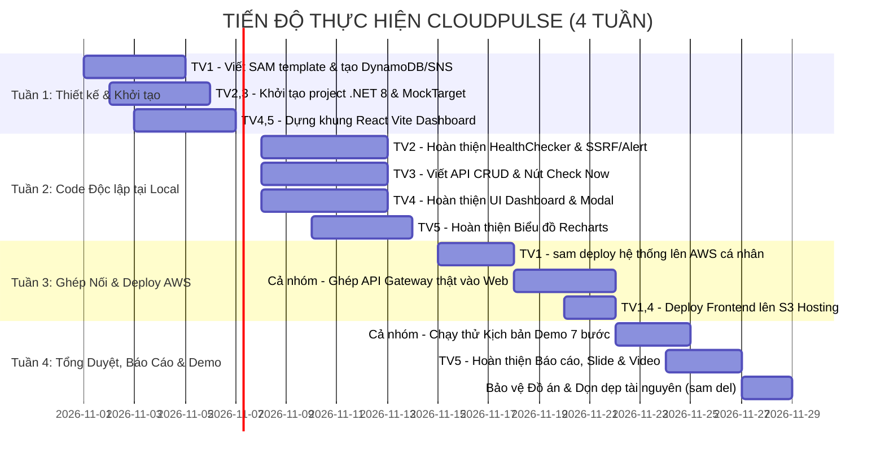

# Bảng Phân Công Nhiệm Vụ Thành Viên (Task Assignment & Duties)

**Dự án**: CloudPulse — Website & API Health Monitoring on AWS  
**Môn học**: Điện toán đám mây (Cloud Computing)  
**Quy mô**: 5 thành viên | **Thời gian**: 4 tuần (1 tháng)  
**Cập nhật lần cuối**: 27/10/2026

---

## 📌 NGUYÊN TẮC LÀM VIỆC NHÓM (RULES OF ENGAGEMENT)

1. **Quy tắc Phân nhánh Git (Branching Model)**:
   * Nhánh chính: `main` (chỉ chứa code đã kiểm thử hoàn chỉnh và sẵn sàng nộp bài).
   * Nhánh phát triển chung: `develop`.
   * Mỗi thành viên tạo nhánh riêng từ `develop` theo cú pháp: `feature/<tên-nhiệm-vụ>`. Sau khi code xong và test chạy được thì tạo Pull Request để merge vào `develop`.
2. **Nguyên tắc Chạy Song Song (Non-blocking Parallelism)**:
   * Frontend sử dụng Mock Data có sẵn trong `frontend/src/api/client.js` để dựng UI ngay trong Tuần 1 và Tuần 2 mà không cần chờ Backend.
   * Backend chia làm 2 project độc lập: Lambda `HealthChecker` (chạy cron) và Lambda `Api` (REST API), tránh xung đột mã nguồn.
3. **Tiêu chuẩn Hoàn thành (Definition of Done - DoD)**:
   * Code có chú thích rõ ràng, tuân thủ Clean Code.
   * Chạy thử không có lỗi cú pháp hoặc crash ứng dụng.
   * Đối chiếu và vượt qua các tiêu chí trong [docs/acceptance-criteria.md](./acceptance-criteria.md).

---

## 📊 MA TRẬN TRÁCH NHIỆM (RACI MATRIX)

* **R (Responsible)**: Người trực tiếp thực hiện công việc.
* **A (Accountable)**: Người chịu trách nhiệm cuối cùng về chất lượng công việc (Leader).
* **C (Consulted)**: Người được tham vấn, phối hợp hỗ trợ.
* **I (Informed)**: Người được thông báo kết quả sau khi hoàn thành.

| Hạng mục Công việc | TV1 (Leader) | TV2 (Engine) | TV3 (API/Mock) | TV4 (UI Core) | TV5 (Metrics/Docs) |
| :--- | :---: | :---: | :---: | :---: | :---: |
| **Quản trị Git & Quản lý Project** | **A / R** | I | I | I | I |
| **Hạ tầng AWS SAM (template.yaml)** | **A / R** | C | C | I | I |
| **Tài khoản AWS & Deploy Cloud** | **A / R** | I | I | I | C |
| **HealthChecker Lambda (Ping & Cron)** | A | **R** | C | I | I |
| **Chống SSRF & State Machine (Lỗi 2 lần)** | A | **R** | I | I | I |
| **Tích hợp SNS Email & Telegram Bot** | A | **R** | I | I | I |
| **Backend REST API (CRUD Monitors)** | A | I | **R** | C | I |
| **Nút "Check Now" API** | A | C | **R** | C | I |
| **MockTarget Lambda (Demo tạo lỗi)** | A | I | **R** | I | C |
| **Dashboard UI (Layout, List, Modal)** | A | I | C | **R** | C |
| **Biểu đồ Latency (Recharts) & Incidents** | A | I | I | C | **R** |
| **CloudWatch Dashboard Log** | A | C | C | I | **R** |
| **Báo cáo Word/PDF, Slide & FinOps** | A | C | C | C | **R** |
| **Diễn tập Kịch bản Demo 7 Bước** | **A** | **R** | **R** | **R** | **R** |

---

## 🎯 PHÂN CÔNG CHI TIẾT TỪNG THÀNH VIÊN

---

### 👑 THÀNH VIÊN 1: Leader / Cloud Architect & DevOps (IaC)

* **Họ và tên**: *(Điền tên thành viên)*
* **Nhánh Git**: `feature/infrastructure-iac`
* **Mục tiêu**: Xây dựng toàn bộ hạ tầng Serverless bằng mã nguồn (AWS SAM) và quản lý tài khoản AWS.

#### Nhiệm vụ cụ thể:
- [ ] **Task 1.1**: Thiết lập repository, phân quyền Git, quản lý việc review và merge code vào nhánh `develop`.
- [ ] **Task 1.2**: Viết và tinh chỉnh file `template.yaml` (AWS SAM):
  - Khai báo 3 bảng DynamoDB On-Demand: `Monitors`, `CheckResults` (kích hoạt TTL 7 ngày), `Incidents`.
  - Khai báo 1 Topic SNS: `CloudPulse_Alerts`.
  - Khai báo 1 HTTP API Gateway v2 hỗ trợ CORS.
  - Khai báo 1 EventBridge Scheduler chạy định kỳ mỗi 1 phút kích hoạt Lambda `HealthChecker`.
  - Cấu hình phân quyền IAM Role Least-Privilege cho các hàm Lambda.
- [ ] **Task 1.3**: Đăng ký và cấu hình tài khoản AWS cá nhân (`aws configure`), quản lý ngân sách Free Tier không để phát sinh chi phí.
- [ ] **Task 1.4**: Chạy lệnh `sam build` và `sam deploy` lên AWS, lấy các giá trị Output URL (API Gateway, MockTarget) bàn giao cho đội Frontend và Backend.
- [ ] **Task 1.5**: Chuẩn bị kế hoạch dọn dẹp tài nguyên (`sam delete`) sau buổi chấm thi.

#### Sản phẩm bàn giao:
* File `template.yaml` chuẩn chỉnh, deploy lên AWS thành công 100% không lỗi.
* Các endpoint URL thực tế trên AWS để cả nhóm tích hợp.

---

### ⚙️ THÀNH VIÊN 2: Backend Core (Health Checker Engine)

* **Họ và tên**: *(Điền tên thành viên)*
* **Nhánh Git**: `feature/backend-health-checker`
* **Mục tiêu**: Lập trình bộ não giám sát chạy ngầm của hệ thống, xử lý phát hiện lỗi và cảnh báo tức thời.

#### Nhiệm vụ cụ thể:
- [ ] **Task 2.1**: Lập trình Lambda **`CloudPulse.HealthChecker`** (.NET 8):
  - Viết Function Handler nhận event định kỳ từ EventBridge Scheduler.
  - Đọc danh sách tất cả website từ bảng DynamoDB `Monitors`.
  - Sử dụng `HttpClient` gửi request kiểm tra song song bằng `Task.WhenAll()` (đặt timeout = 5 giây).
- [ ] **Task 2.2**: Lập trình module **`UrlValidator`** trong `CloudPulse.Core`:
  - Kiểm tra định dạng URL (chỉ nhận `http://` và `https://`).
  - Chống tấn công SSRF: Chặn tuyệt đối IP localhost (`127.0.0.1`), Private IP (`10.x`, `172.16-31.x`, `192.168.x`) và AWS Metadata IP (`169.254.169.254`).
- [ ] **Task 2.3**: Xây dựng **State Machine** chống báo động giả:
  - Đo thời gian phản hồi (ms) và phân loại mã lỗi (2xx/3xx = SUCCESS; 4xx/5xx/Timeout = FAIL).
  - Tăng biến `consecutiveFailures`. Đúng **ngưỡng $\ge 2$ lần lỗi liên tiếp** mới chuyển trạng thái sang `DOWN`.
  - Tự động tạo bản ghi mới trong bảng `Incidents` (Status: `OPEN`) khi chuyển sang DOWN.
  - Tự động chuyển về `UP`, đóng Incident (Status: `RESOLVED`) và tính tổng thời gian downtime khi website hồi phục.
- [ ] **Task 2.4**: Tích hợp kênh cảnh báo đa kênh:
  - Bắn email thông báo qua **Amazon SNS** (`PublishAsync`).
  - Gửi tin nhắn tức thì có chuông báo qua **Telegram Bot API** (`https://api.telegram.org/bot<token>/sendMessage`).
  - Đảm bảo **chống spam alert**: Chỉ gửi duy nhất 1 lần khi chuyển DOWN và 1 lần khi hồi phục UP.

#### Sản phẩm bàn giao:
* Lambda `CloudPulse.HealthChecker` hoàn chỉnh. Khi cố tình tắt website, hệ thống tự động phát hiện sau 2 phút và gửi tin nhắn về điện thoại/email.

---

### 🔌 THÀNH VIÊN 3: Backend API & Mock Target Service

* **Họ và tên**: *(Điền tên thành viên)*
* **Nhánh Git**: `feature/backend-api-mock`
* **Mục tiêu**: Xây dựng hệ thống REST API cho Dashboard và dịch vụ Mock tạo lỗi phục vụ demo.

#### Nhiệm vụ cụ thể:
- [ ] **Task 3.1**: Lập trình Lambda **`CloudPulse.Api`** (ASP.NET Core Minimal API tích hợp `Amazon.Lambda.AspNetCoreServer.Hosting`):
  - `GET /api/monitors`: Lấy danh sách toàn bộ website và trạng thái hiện tại.
  - `POST /api/monitors`: Tiếp nhận URL mới, gọi `UrlValidator` kiểm tra SSRF, lưu vào DynamoDB `Monitors`.
  - `GET /api/monitors/{id}`: Xem chi tiết 1 monitor.
  - `DELETE /api/monitors/{id}`: Xóa website khỏi danh sách theo dõi.
  - `GET /api/monitors/{id}/checks`: Query danh sách 30-50 kết quả kiểm tra gần nhất để vẽ biểu đồ.
  - `GET /api/monitors/{id}/incidents`: Query lịch sử các đợt sự cố đã xảy ra.
- [ ] **Task 3.2**: Lập trình API cho nút **"Check Now"** (`POST /api/monitors/{id}/check`):
  - Gửi request kiểm tra ngay lập tức tới URL đích bằng `HttpClient`.
  - Đo chính xác thời gian phản hồi (ms) bằng `Stopwatch`.
  - Lưu kết quả vào `CheckResults`, cập nhật trạng thái trong `Monitors` và trả về kết quả trong $\le 2$ giây.
- [ ] **Task 3.3**: Lập trình Lambda **`CloudPulse.MockTarget`** phục vụ kịch bản demo:
  - Nhận query params để đổi trạng thái trả về linh hoạt:
    - `GET /mock` $\rightarrow$ Trả về `200 OK`.
    - `GET /mock?status=500` $\rightarrow$ Trả về `500 Internal Server Error`.
    - `GET /mock?delay=7000` $\rightarrow$ Treo 7 giây để tạo lỗi Timeout.

#### Sản phẩm bàn giao:
* Bộ API RESTful hoàn chỉnh kết nối với DynamoDB.
* Dịch vụ MockTarget sẵn sàng tạo lỗi khi thuyết trình.

---

### 🎨 THÀNH VIÊN 4: Frontend Lead (React + Vite + UI/UX)

* **Họ và tên**: *(Điền tên thành viên)*
* **Nhánh Git**: `feature/frontend-dashboard`
* **Mục tiêu**: Xây dựng toàn bộ khung giao diện Dashboard hiện đại, mượt mà theo chuẩn TasteSkill Light Theme.

#### Nhiệm vụ cụ thể:
- [ ] **Task 4.1**: Thiết lập môi trường `frontend/` (React 18 + Vite + TailwindCSS), đảm bảo lệnh `npm run dev` và `npm run build` chạy mượt mà.
- [ ] **Task 4.2**: Xây dựng **Navbar Component**:
  - Logo CloudPulse thương hiệu, đồng hồ hiển thị giờ UTC thời gian thực.
  - Chip hiển thị AWS Region và tần suất cron `rate(1m)`.
  - Nút **Sync** làm mới dữ liệu kèm hiệu ứng xoay tròn và nút **"Thêm Monitor"**.
- [ ] **Task 4.3**: Xây dựng **StatsOverview Component**:
  - 4 thẻ thống kê: Tỷ lệ Uptime (%), Số sự cố Critical đang mở, Số lượng Endpoint, Độ trễ trung bình p95.
- [ ] **Task 4.4**: Xây dựng **MonitorList Component**:
  - Thanh tìm kiếm nhanh theo tên/URL.
  - Bộ lọc trạng thái theo tab: `ALL`, `UP`, `DOWN`.
  - Thẻ hiển thị website: Tên, URL, badge trạng thái, hiệu ứng sóng **Radar Ping** (xanh khi UP, đỏ khi DOWN).
  - Tích hợp nút **"Check Now"** (có hiệu ứng loading khi đang kiểm tra) và nút xóa endpoint.
- [ ] **Task 4.5**: Xây dựng **AddMonitorModal Component**:
  - Hộp thoại popup nhập Tên và URL website.
  - Tích hợp sẵn 3 nút chọn nhanh link demo (`Mock 200`, `Mock 500`, `Mock Timeout`).
  - Kiểm tra và hiển thị cảnh báo ngay lập tức nếu người dùng nhập IP nhạy cảm (SSRF warning).

#### Sản phẩm bàn giao:
* Giao diện Dashboard hoàn chỉnh, trực quan, tương thích tốt trên cả máy tính và điện thoại.

---

### 📊 THÀNH VIÊN 5: Frontend Metrics, Observability & Báo Cáo / Slide

* **Họ và tên**: *(Điền tên thành viên)*
* **Nhánh Git**: `feature/frontend-metrics-docs`
* **Mục tiêu**: Trực quan hóa dữ liệu đo đạc (charts), chuẩn bị bằng chứng CloudWatch, viết Báo cáo Word/PDF và làm Slide thuyết trình.

#### Nhiệm vụ cụ thể:
- [ ] **Task 5.1**: Lập trình component **`LatencyChart`** (thư viện Recharts):
  - Biểu đồ diện tích (AreaChart) dải màu Sky Blue thể hiện biến thiên thời gian phản hồi (ms) theo từng phút.
  - Tính toán và hiển thị các chip thống kê: `MIN`, `AVG`, `MAX` (ms).
  - Tooltip hiển thị mã HTTP Status Code và mili-giây chính xác khi rê chuột vào điểm dữ liệu.
- [ ] **Task 5.2**: Lập trình component **`IncidentHistory`**:
  - Bảng danh sách dòng thời gian các đợt sự cố.
  - Hiển thị nhãn `OPEN` (màu đỏ) hoặc `RESOLVED` (màu xanh), nguyên nhân lỗi và tổng thời gian gián đoạn (ví dụ: `124s downtime`).
- [ ] **Task 5.3**: Thiết lập **CloudWatch Dashboard & Logs**:
  - Thu thập log thực thi của Lambda để chụp ảnh làm bằng chứng trong báo cáo.
- [ ] **Task 5.4**: Soạn thảo **Báo cáo Đồ án (Word/PDF)** và **Slide Thuyết trình**:
  - Trình bày bài toán thực tế (Phase 1 — Discovery).
  - Bảng so sánh chi phí **FinOps (\$0 Free Tier vs \$50 CloudWatch Synthetics)**.
  - Vẽ sơ đồ kiến trúc hệ thống và giải thích các dịch vụ AWS đã sử dụng.
- [ ] **Task 5.5**: Lên kịch bản và **quay sẵn 1 Video Demo 7 bước dự phòng** (đề phòng phòng thi mất mạng).

#### Sản phẩm bàn giao:
* Component biểu đồ và lịch sử sự cố hoàn thiện trên web.
* File Báo cáo Word/PDF và Slide thuyết trình chuyên nghiệp, sẵn sàng bảo vệ đồ án.

---

## 📅 LỘ TRÌNH THỰC HIỆN 4 TUẦN (TIMELINE MILESTONES)

---

*Tài liệu này là cơ sở chính thức để đánh giá mức độ đóng góp và chấm điểm cá nhân của từng thành viên trong đồ án.*
