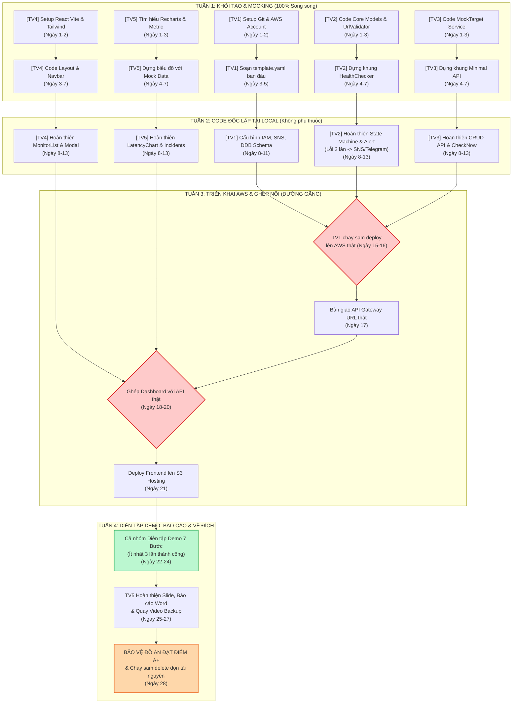

# Bảng Điều Phối Lộ Trình & Quản Trị Phụ Thuộc (Lead Master Roadmap)

**Dành riêng cho**: Trưởng nhóm / Quản lý Kỹ thuật (Leader / Tech Lead)  
**Dự án**: CloudPulse — Website & API Health Monitoring on AWS  
**Quy mô**: 5 thành viên | **Thời gian**: 4 tuần (1 tháng)  
**Nguyên tắc cốt lõi**: **Khóa toàn bộ mã nguồn ở Tuần 3 (Hard Code-Freeze)** — Dành trọn Tuần 4 để diễn tập kịch bản demo 7 bước, hoàn thiện báo cáo và slide thuyết trình nhằm đảm bảo 100% dự án thành công.

---

## 1. SƠ ĐỒ ĐƯỜNG GĂNG & LUỒNG PHỤ THUỘC (CRITICAL PATH METHOD - CPM)

Sơ đồ dưới đây chỉ rõ chuỗi công việc nào là **Đường găng (Critical Path - nét đỏ/chính)** bắt buộc phải xong đúng hạn, và những việc nào có thể **chạy song song (Parallel Streams)** mà không làm nghẽn tiến độ của người khác.



---

## 2. BẢNG PHÂN RÃ CÔNG VIỆC CHI TIẾT THEO 4 TUẦN

---

### TUẦN 1: KHỞI TẠO HẠ TẦNG, MOCKING & BỘ KHUNG GIAO DIỆN
> **Mục tiêu tuần (Sprint Goal)**: Tất cả thành viên có môi trường code hoàn chỉnh. Frontend dựng được khung trang web bằng Mock Data. Backend có MockTarget để test.

| Mã Task | Tên Công việc | Người làm | Hạn (Ngày) | Phụ thuộc | Làm song song | Đầu ra nghiệm thu (DoD) |
| :---: | :--- | :---: | :---: | :---: | :---: | :--- |
| **W1-01** | Tạo Repo, nhánh Git, cấp quyền cho 5 thành viên | **TV1** | Ngày 1–2 | Không | Song song W1-04 | 5 thành viên clone được repo, nhánh `develop` sẵn sàng. |
| **W1-02** | Tạo tài khoản AWS cá nhân, cấu hình Access Key | **TV1** | Ngày 2–3 | Không | Song song W1-03 | Chạy được lệnh `aws sts get-caller-identity` không lỗi. |
| **W1-03** | Viết file `template.yaml` ban đầu (3 bảng DynamoDB, SNS) | **TV1** | Ngày 3–6 | W1-02 | Song song W1-05 | File `template.yaml` vượt qua lệnh `sam validate --lint`. |
| **W1-04** | Viết Models (`Monitor`, `Check`, `Incident`) trong `Core` | **TV2** | Ngày 1–3 | W1-01 | Song song W1-06 | Các class C# định nghĩa đầy đủ trường dữ liệu. |
| **W1-05** | Viết module `UrlValidator` (chặn SSRF & IP private) | **TV2** | Ngày 4–6 | W1-04 | Song song W1-07 | Chặn được `127.0.0.1`, `10.x`, `169.254.169.254`. |
| **W1-06** | Lập trình Lambda `CloudPulse.MockTarget` | **TV3** | Ngày 1–4 | W1-01 | Song song W1-04 | MockTarget trả về đúng 200, 500, và timeout khi có param. |
| **W1-07** | Dựng khung ASP.NET Core Minimal API rỗng | **TV3** | Ngày 5–7 | W1-04 | Song song W1-05 | Chạy `dotnet run` lên Swagger hoặc trả về JSON status. |
| **W1-08** | Khởi tạo React 18 + Vite + TailwindCSS | **TV4** | Ngày 1–2 | W1-01 | Song song W1-01 | Chạy `npm run dev` mở được trang web local port 3000. |
| **W1-09** | Xây dựng Navbar (giờ UTC) và StatsOverview | **TV4** | Ngày 3–7 | W1-08 | Song song W1-10 | Hiển thị đồng hồ thời gian thực và 4 thẻ thống kê. |
| **W1-10** | Dựng biểu đồ Recharts với Mock Data trong `client.js` | **TV5** | Ngày 3–7 | W1-08 | Song song W1-09 | Biểu đồ LatencyChart vẽ được đường nét mượt mà. |

> ⚠️ **Hành động của Lead ở Tuần 1**: Họp chốt cấu trúc JSON giữa TV2, TV3 và TV4 vào **tối Ngày 3** để đảm bảo tên các trường dữ liệu (`monitorId`, `status`, `responseTimeMs`) đồng nhất 100%.

---

### TUẦN 2: LẬP TRÌNH ĐỘC LẬP TẠI LOCAL (NON-BLOCKING DEVELOPMENT)
> **Mục tiêu tuần (Sprint Goal)**: Toàn bộ logic nghiệp vụ (State Machine, Alerting, CRUD, Dashboard) chạy trơn tru ở máy local của từng bạn.

| Mã Task | Tên Công việc | Người làm | Hạn (Ngày) | Phụ thuộc | Làm song song | Đầu ra nghiệm thu (DoD) |
| :---: | :--- | :---: | :---: | :---: | :---: | :--- |
| **W2-01** | Cấu hình IAM Least Privilege & EventBridge Cron 1m | **TV1** | Ngày 8–10 | W1-03 | Song song W2-02 | `template.yaml` có đầy đủ quyền DynamoDBCrud & SNS. |
| **W2-02** | Đăng ký Topic SNS Email & chuẩn bị xác nhận hòm thư | **TV1** | Ngày 11–13| W2-01 | Song song W2-04 | Topic ARN được sinh ra và sẵn sàng gửi email. |
| **W2-03** | Lập trình Worker ping HTTP song song (`Task.WhenAll`) | **TV2** | Ngày 8–10 | W1-05 | Song song W2-05 | Ping đồng thời nhiều URL, mỗi URL timeout đúng 5s. |
| **W2-04** | Lập trình State Machine: Lỗi 2 lần liên tiếp $\rightarrow$ DOWN | **TV2** | Ngày 11–12| W2-03 | Song song W2-06 | Chỉ chuyển DOWN và tạo Incident khi đếm đủ 2 lần FAIL. |
| **W2-05** | Tích hợp gửi cảnh báo SNS Email & Telegram Bot API | **TV2** | Ngày 12–14| W2-04 | Song song W2-07 | Khi DOWN nảy tin nhắn Telegram 🚨 và nhận được 1 email. |
| **W2-06** | Viết các endpoint CRUD Monitors trong `CloudPulse.Api` | **TV3** | Ngày 8–11 | W1-07 | Song song W2-03 | Gọi `GET /api/monitors`, `POST /api/monitors` lưu vào DDB. |
| **W2-07** | Viết endpoint nút "Check Now" (`POST .../check`) | **TV3** | Ngày 12–14| W2-06 | Song song W2-05 | Bấm check trả kết quả đo latency trong $\le 2$ giây. |
| **W2-08** | Hoàn thiện MonitorList (tìm kiếm, tab filter, radar ping) | **TV4** | Ngày 8–11 | W1-09 | Song song W2-06 | Lọc được `ALL/UP/DOWN`, badge đổi màu theo trạng thái. |
| **W2-09** | Hoàn thiện AddMonitorModal (nút chọn link demo, chặn SSRF)| **TV4** | Ngày 12–14| W2-08 | Song song W2-07 | Bấm preset tự điền URL, nhập 127.0.0.1 báo lỗi đỏ. |
| **W2-10** | Hoàn thiện IncidentHistory (dòng thời gian downtime) | **TV5** | Ngày 8–11 | W1-10 | Song song W2-08 | Hiển thị nhãn OPEN/RESOLVED và số giây gián đoạn. |
| **W2-11** | Soạn đề cương Báo cáo Đồ án & Slide thuyết trình | **TV5** | Ngày 12–14| W1-01 | Song song W2-09 | Có khung slide 15 trang và dàn bài Word theo chuẩn trường. |

> ⚠️ **Hành động của Lead ở Tuần 2**: Tổ chức họp review code vào **tối Ngày 14**. Yêu cầu từng bạn demo chạy thử trên máy local. **Tất cả Pull Request phải được merge vào nhánh `develop`**.

---

### TUẦN 3: TRIỂN KHAI AWS & GHÉP NỐI TOÀN DIỆN (ĐƯỜNG GĂNG QUYẾT ĐỊNH)
> **Mục tiêu tuần (Sprint Goal)**: Đưa toàn bộ hệ thống lên Cloud AWS thật. Frontend gọi API Gateway thật. Khóa toàn bộ code (Code Freeze) vào ngày cuối tuần.

| Mã Task | Tên Công việc | Người làm | Hạn (Ngày) | Phụ thuộc | Làm song song | Đầu ra nghiệm thu (DoD) |
| :---: | :--- | :---: | :---: | :---: | :---: | :--- |
| **W3-01** | Chạy `sam build` và `sam deploy` lên AWS thật | **TV1** | Ngày 15–16| W2-01,05,07| Không (Blocker) | CloudFormation Stack CREATE_COMPLETE. Xuất ra API URL. |
| **W3-02** | Bàn giao API Gateway URL thật và kiểm tra quyền CORS | **TV1** | Ngày 17   | W3-01 | Song song W3-03 | Trình duyệt gọi OPTIONS không bị lỗi CORS chặn. |
| **W3-03** | Bấm link xác nhận "Confirm Subscription" email SNS | **TV1, TV2**| Ngày 17 | W3-01 | Song song W3-02 | Hòm thư quản trị viên ở trạng thái "Confirmed". |
| **W3-04** | Ghép nối Frontend với API Gateway thật trên AWS | **TV4, TV3**| Ngày 18–19| W3-02 | Song song W3-05 | Tạo website mới trên Dashboard lưu thẳng vào DynamoDB thật. |
| **W3-05** | Kiểm tra nút "Check Now" và Biểu đồ nhận data thật | **TV5, TV4**| Ngày 19–20| W3-04 | Song song W3-06 | Biểu đồ Recharts vẽ dữ liệu thực tế lấy từ DynamoDB. |
| **W3-06** | Kiểm tra Worker chạy tự động mỗi phút qua EventBridge | **TV2, TV1**| Ngày 19–20| W3-01 | Song song W3-05 | CloudWatch Logs ghi nhận Lambda thức dậy đều đặn mỗi phút. |
| **W3-07** | Build production (`npm run build`) và deploy lên S3 Hosting| **TV1, TV4**| Ngày 21   | W3-04,05 | Không | Có link web online truy cập được bằng điện thoại/laptop. |

> 🚨 **CẢNH BÁO QUAN TRỌNG CHO LEAD Ở NGÀY 21**:
> **ĐÚNG 23:59 NGÀY 21 LÀ THỜI ĐIỂM KHÓA CODE (CODE FREEZE)**. Bất kể ai muốn thêm tính năng gì mới đều phải từ chối để bảo vệ hệ thống ổn định!

---

### TUẦN 4: DIỄN TẬP KỊCH BẢN DEMO 7 BƯỚC, BÁO CÁO & BẢO VỆ ĐỒ ÁN
> **Mục tiêu tuần (Sprint Goal)**: Cả nhóm thuần thục kịch bản thuyết trình, có video backup, slide chuyên nghiệp và tự tin đạt điểm A+.

| Mã Task | Tên Công việc | Người làm | Hạn (Ngày) | Phụ thuộc | Làm song song | Đầu ra nghiệm thu (DoD) |
| :---: | :--- | :---: | :---: | :---: | :---: | :--- |
| **W4-01** | Diễn tập Kịch bản Demo 7 bước lần 1 & ghi nhận lỗi | **Cả nhóm**| Ngày 22   | W3-07 | Không | Phát hiện và khắc phục các điểm ngắc ngứ trong demo. |
| **W4-02** | Diễn tập Kịch bản Demo 7 bước lần 2 & 3 (Không vấp) | **Cả nhóm**| Ngày 23–24| W4-01 | Song song W4-03 | Demo trơn tru từ tạo lỗi $\rightarrow$ cảnh báo $\rightarrow$ khôi phục. |
| **W4-03** | Chụp ảnh CloudWatch Logs & bảng tính chi phí FinOps | **TV5, TV1**| Ngày 22–24| W4-01 | Song song W4-02 | Có đầy đủ hình ảnh minh chứng hóa đơn AWS \$0.00. |
| **W4-04** | Hoàn thiện Slide thuyết trình PowerPoint/Canva | **TV5, TV4**| Ngày 25   | W4-03 | Song song W4-05 | Slide 15–20 trang đẹp mắt, đúng chuẩn học thuật. |
| **W4-05** | Hoàn thiện Báo cáo Đồ án bản Word / PDF nộp trường | **TV5, TV2**| Ngày 25–26| W4-03 | Song song W4-04 | File báo cáo 30–40 trang đầy đủ sơ đồ, code snippet. |
| **W4-06** | **Quay 1 Video Demo chất lượng cao (Backup Video)** | **TV5** | Ngày 26   | W4-02 | Song song W4-05 | Video 5 phút có thuyết minh, lưu sẵn trong USB/Drive. |
| **W4-07** | Tổng duyệt thuyết trình lần cuối (Dry Run) | **Cả nhóm**| Ngày 27   | W4-04,06 | Không | Phân công ai nói phần nào, canh đúng thời lượng 15 phút. |
| **W4-08** | **BẢO VỆ ĐỒ ÁN TRƯỚC HỘI ĐỒNG & DỌN DẸP HẠ TẦNG** | **Cả nhóm**| Ngày 28   | W4-07 | Không | Thuyết trình tự tin, sau đó chạy `sam delete` xóa sạch AWS. |

---

## 3. MA TRẬN PHỤ THUỘC CHÉO ("AI ĐANG ĐỢI AI?")

Bảng tra cứu nhanh giúp Leader giải tỏa điểm nghẽn (Unblock) hàng ngày:

```text
┌─────────────────┬───────────────────────────────┬──────────────────────────────────────────────┐
│ Người Đang Đợi  │ Đang Đợi Ai / Việc Gì?        │ Hành Động Của Leader Để Giải Tỏa (Unblock)    │
├─────────────────┼───────────────────────────────┼──────────────────────────────────────────────┤
│ TV2 (Health)    │ Đợi TV1 cấp quyền IAM / SNS   │ TV1 viết sẵn các Resource trong template     │
│                 │                               │ để TV2 test cục bộ trước bằng Mock.          │
├─────────────────┼───────────────────────────────┼──────────────────────────────────────────────┤
│ TV3 (API)       │ Đợi DynamoDB schema từ TV1    │ Dùng schema 3 bảng chuẩn đã chốt trong spec:  │
│                 │                               │ Monitors, CheckResults, Incidents.           │
├─────────────────┼───────────────────────────────┼──────────────────────────────────────────────┤
│ TV4 (UI Core)   │ Đợi API thật từ TV3           │ TUYỆT ĐỐI KHÔNG CHỜ: Dùng ngay Mock Data     │
│                 │                               │ trong frontend/src/api/client.js.            │
├─────────────────┼───────────────────────────────┼──────────────────────────────────────────────┤
│ TV5 (Charts)    │ Đợi UI từ TV4                 │ Code trực tiếp component LatencyChart.jsx     │
│                 │                               │ độc lập, sau đó import vào App.jsx.          │
├─────────────────┼───────────────────────────────┼──────────────────────────────────────────────┤
│ CẢ NHÓM (Tuần 3)│ Đợi TV1 deploy AWS            │ TV1 phải hoàn thành lệnh deploy muộn nhất    │
│                 │                               │ vào ngày 16. Nếu TV1 kẹt, TV2/TV3 nhảy vào   │
│                 │                               │ hỗ trợ debug lỗi CloudFormation ngay lập tức.│
└─────────────────┴───────────────────────────────┴──────────────────────────────────────────────┘
```

---

## 4. KẾ HOẠCH DỰ PHÒNG RỦI RO (CONTINGENCY & BUFFER PLAN)

### Tình huống 1: Một thành viên bị ốm hoặc bận việc đột xuất
* **Quy tắc Ghép cặp (Pairing)**:
  * **Cặp Backend**: TV2 & TV3 cùng biết C# .NET 8 $\rightarrow$ Nếu 1 trong 2 bạn bị trễ, bạn còn lại tiếp quản task ngay.
  * **Cặp Frontend/Docs**: TV4 & TV5 cùng biết React & văn bản $\rightarrow$ Hỗ trợ chéo cho nhau.
  * Leader (TV1) đóng vai trò "cứu hỏa" cơ động, sẵn sàng nhảy vào gỡ lỗi cho cả hai bên.

### Tình huống 2: Sát ngày bảo vệ mạng hội trường bị rớt hoặc giật lag
* **Giải pháp**: Đây là lý do vì sao có task **W4-06 (Quay Video Demo dự phòng)**. Nếu mạng trường không vào được AWS, bạn bình tĩnh xin phép Thầy/Cô chiếu Video Demo 5 phút đã quay sẵn. Hội đồng sẽ đánh giá rất cao sự chu đáo và tính chuyên nghiệp của nhóm.

### Tình huống 3: Tài khoản AWS gặp sự cố thẻ tín dụng
* **Giải pháp**: Nhóm có thể khởi động lại hệ thống ở máy local trong vòng 30 giây (`dotnet run` cho backend và `npm run dev` cho frontend) và dùng link local để demo trực tiếp.

---

## 5. BẢN HƯỚNG DẪN HỌP ĐIỀU HÀNH HÀNG TUẦN (STANDUP SCRIPT)

Leader mở file này ra vào **21:00 tối Chủ Nhật hàng tuần** và đặt đúng 3 câu hỏi cho từng thành viên:

1. *"Trong tuần qua, bạn đã hoàn thành những mã task nào? Đã tick vào checklist chưa?"*
2. *"Tuần tới bạn sẽ làm những task nào theo kế hoạch của Sprint mới?"*
3. *"Bạn có đang bị vướng mắc kỹ thuật nào cần Leader hoặc AI giải quyết hộ không?"*

> **Châm ngôn của Leader**: *"Không đợi đến hạn mới hỏi, kiểm tra tiến độ mỗi 3 ngày để phát hiện chậm trễ từ trong trứng nước."*
