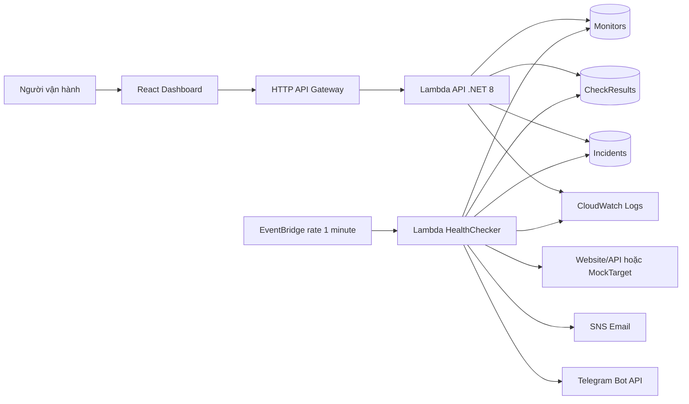

# CloudPulse — Bản thảo Chương 3 và khung Chương 4–5

Ngày cập nhật: 11/11/2026. TV5. Ghép tiếp sau [Chương 1–2](tv5-report-week2.md), theo [dàn bài báo cáo](tv5-report-outline.md).

Nguồn thiết kế: `template.yaml`, các entity trong `backend/src/CloudPulse.core/entity`, API `backend/src/CloudPulse.Api/Program.cs`, yêu cầu và tiêu chí nghiệm thu của repo. Backend đã được nhóm bàn giao URL tại ap-southeast-1; cấu hình trong mã nguồn chưa thay thế bằng chứng cấu hình đang chạy trên AWS.

## Chương 3. Thiết kế kiến trúc

### 3.1. Lựa chọn kiến trúc Serverless

CloudPulse tách giao diện quản lý khỏi tiến trình kiểm tra theo lịch. React gọi REST API để quản lý monitor và đọc lịch sử; tiến trình kiểm tra vẫn chạy khi người dùng đóng Dashboard. Lambda thực thi theo sự kiện, DynamoDB lưu trạng thái và lịch sử, EventBridge kích hoạt định kỳ. Nhóm không phải duy trì máy chủ chạy liên tục, nhưng cần quản lý timeout, cold start, quyền truy cập và chi phí theo mức sử dụng.

Sơ đồ thể hiện luồng logic. Trong SAM hiện tại, sự kiện `Schedule` tạo lịch EventBridge; không mô tả đây là tài nguyên `AWS::Scheduler::Schedule`. Check Now thực thi trong API; cần đối chiếu hành vi cập nhật Incident/cảnh báo của đường này với HealthChecker khi nghiệm thu.

### 3.2. Vai trò các thành phần

| Thành phần | Trách nhiệm | Điểm cần kiểm chứng khi triển khai |
| --- | --- | --- |
| React/Vite | Danh sách, chọn monitor, Sync, Check Now, biểu đồ và lịch sử | API base URL, CORS, xử lý lỗi và dữ liệu rỗng |
| HTTP API Gateway | Cung cấp điểm truy cập REST và chuyển request tới Lambda API | Route, HTTP status, origin được phép |
| Lambda API (.NET 8) | CRUD Monitors, kiểm tra thủ công, query checks/incidents | DTO, validation, timeout, tương thích giao diện |
| EventBridge | Kích hoạt HealthChecker mỗi phút | Log nhiều lần chạy; retry và trùng sự kiện |
| Lambda HealthChecker | Kiểm tra HTTP song song, đo latency, cập nhật trạng thái, cảnh báo | 200/500/timeout, hai FAIL, recovery |
| DynamoDB | Lưu ba loại dữ liệu với truy vấn theo monitor | Khóa, TTL, quyền đọc/ghi và dung lượng |
| SNS và Telegram | Chuyển cảnh báo DOWN/UP tới người vận hành | Email xác nhận subscription, nội dung và thời gian nhận |
| CloudWatch Logs | Log thực thi phục vụ truy vết và đo thời gian | Correlation/monitor ID, retention, không lộ token |
| AWS SAM và IAM | Khai báo hạ tầng và quyền thực thi bằng mã nguồn | Stack outputs, role thực tế, thay đổi cấu hình |

### 3.3. Thiết kế dữ liệu DynamoDB

Ba bảng trong SAM dùng `PAY_PER_REQUEST`. Timestamp nghiệp vụ lưu chuỗi UTC ISO 8601; giao diện Incident hiển thị giờ Việt Nam. Latency dùng mili giây; downtime dùng giây.

| Bảng vật lý | Partition key | Sort key | Thuộc tính chính | Mẫu truy cập |
| --- | --- | --- | --- | --- |
| `CloudPulse_Monitors` | `monitorId` (S) | Không | name, url, status, intervalSeconds, consecutiveFailures, lastCheckedAt, lastResponseTimeMs, lastStatusCode, createdAt, updatedAt | Danh sách; đọc/cập nhật/xóa theo ID |
| `CloudPulse_CheckResults` | `monitorId` (S) | `checkedAt` (S) | httpStatus, responseTimeMs, isSuccess, errorType, errorMessage, expireAt | Query các lượt gần nhất của một monitor |
| `CloudPulse_Incidents` | `monitorId` (S) | `incidentId` (S) | status, openedAt, resolvedAt, reason, downtimeSeconds | Query sự cố theo monitor; mở/đóng sự cố |

`expireAt` là Unix epoch **giây**, mặc định thời điểm tạo cộng 7 ngày. SAM bật TTL trên đúng thuộc tính này của CheckResults. TTL là cơ chế dọn dữ liệu bất đồng bộ, không phải cam kết bản ghi biến mất đúng giây hết hạn. Monitors và Incidents không khai báo TTL trong template hiện tại. Việc xóa monitor không mặc nhiên chứng minh lịch sử đã được xóa dây chuyền; phải kiểm tra riêng nếu yêu cầu bổ sung.

API checks trả mảng `{ time, responseTimeMs, statusCode }` để chart dùng trực tiếp. API incidents được frontend ánh xạ `incidentId → id`, `openedAt → startedAt`, `reason → cause`, giữ status/resolvedAt/downtimeSeconds và gắn tên monitor đang chọn. Chart tính MIN/AVG/MAX trên các điểm hợp lệ đang hiển thị; các số này không phải percentile toàn hệ thống.

### 3.4. Luồng kiểm tra và State Machine

Mỗi lượt kiểm tra đọc monitor, xác thực URL, gửi HTTP với giới hạn thời gian theo cấu hình (mục tiêu 5.000 ms), ghi CheckResult rồi cập nhật trạng thái. Theo yêu cầu, HTTP 200–399 là SUCCESS; 4xx/5xx, timeout, DNS/SSL/kết nối thất bại là FAIL. Bằng chứng kiểm thử phải thể hiện cả kết quả HTTP và trạng thái trước/sau.

| Trạng thái trước | Kết quả | Trạng thái sau | Tác động nghiệp vụ mong đợi |
| --- | --- | --- | --- |
| UNKNOWN hoặc UP, bộ đếm 0 | FAIL lần 1 | Giữ trạng thái, bộ đếm 1 | Lưu check, chưa mở Incident |
| UNKNOWN hoặc UP, bộ đếm 1 | FAIL lần 2 | DOWN, bộ đếm ≥ 2 | Mở OPEN và gửi DOWN một lần |
| DOWN | FAIL tiếp | DOWN | Lưu check, không tạo cảnh báo DOWN lặp |
| DOWN | SUCCESS | UP, bộ đếm 0 | Đóng RESOLVED, tính downtime, gửi recovery |
| UNKNOWN hoặc UP | SUCCESS | UP, bộ đếm 0 | Không gửi cảnh báo recovery giả |

Ví dụ: 10:00 FAIL 1; 10:01 FAIL 2 và mở Incident; 10:02 FAIL tiếp; 10:03 SUCCESS và đóng Incident. Downtime được ghi nhận khoảng 120 giây từ thời điểm xác nhận DOWN, không bao gồm khoảng lỗi trước khi phát hiện. Đây là ví dụ minh họa, không phải số đo AWS.

State Machine ở đây là logic ứng dụng, không phải dịch vụ AWS Step Functions. Chống spam theo chuyển trạng thái cần được kiểm thử thêm khi Scheduler retry hoặc Check Now trùng lượt định kỳ. Không khẳng định exactly-once nếu chưa có bằng chứng về cập nhật có điều kiện/idempotency và gửi thông báo.

### 3.5. Bảo mật SSRF

URL là dữ liệu đầu vào không tin cậy. Backend phải kiểm tra khi thêm monitor và trước khi thực hiện request; kiểm tra trên UI chỉ hỗ trợ người dùng. `UrlValidator` giới hạn HTTP(S), chặn loopback/localhost, IPv4 private, link-local/metadata và các dải IPv6 nội bộ; với domain, kiểm tra các IP phân giải được.

Các ca cần nghiệm thu gồm `127.0.0.1`, `10.0.0.1`, `172.16.0.1`, `192.168.1.1`, `169.254.169.254`, `::1`, IPv4-mapped IPv6 và domain trỏ về IP nội bộ. Cần kiểm tra redirect và thay đổi DNS giữa validation với kết nối để đánh giá DNS rebinding; chỉ kiểm tra DNS trước request chưa đủ chứng minh phòng vệ hoàn chỉnh. Log chỉ ghi lý do từ chối phù hợp, không ghi Telegram token hoặc thông tin xác thực URL.

### 3.6. IAM Least Privilege và giới hạn triển khai

Mỗi Lambda cần role theo nhiệm vụ: API truy cập dữ liệu phục vụ CRUD và Check Now; HealthChecker đọc monitor, ghi kết quả/trạng thái/Incident và publish đúng SNS topic; MockTarget không cần quyền DynamoDB/SNS. EventBridge chỉ được invoke đúng checker. Quyền log giới hạn theo nhóm log tương ứng khi triển khai.

SAM hiện dùng `DynamoDBCrudPolicy` theo từng bảng và `SNSPublishMessagePolicy` theo topic cho checker. Đây là giới hạn tài nguyên bước đầu; policy CRUD vẫn rộng hơn tập action tối thiểu của từng hàm. TV1 cần đối chiếu policy đã triển khai, thu hẹp action nếu phù hợp. Globals hiện truyền biến Telegram xuống các hàm; nên giới hạn nơi nhận bí mật theo nhu cầu. Không ghi nhận Least Privilege đã hoàn tất nếu chưa có bản xuất IAM thực tế.

HTTP API hiện cho phép CORS `*`, và MVP chưa có xác thực đa người dùng. CORS không thay thế xác thực. Mở rộng sử dụng ngoài demo cần xác định truy cập, origin và quyền người dùng phù hợp.

## Chương 4. Triển khai — khung ghép bằng chứng

### 4.1. Môi trường và cấu hình

Frontend: React 18, Vite, TailwindCSS, Recharts. Backend: .NET 8, AWS SAM. Vùng bàn giao: ap-southeast-1. URL AWS lưu trong `frontend/.env` cục bộ, không commit; mẫu cấu hình nằm ở `frontend/.env.example`. Sau đổi env cần khởi động lại Vite.

`App.jsx` giữ lựa chọn monitor, tải song song checks/incidents khi đổi lựa chọn hoặc sau Sync/Check Now, và bỏ qua response thuộc lần tải đã hết hiệu lực. API lỗi hiển thị thông báo và cho Sync lại; chỉ fallback mock khi không cấu hình API base URL. Không chuyển âm thầm về mock khi API thật lỗi.

### 4.2. Bảng ảnh và code cần chèn

| Mã bằng chứng | Vị trí chèn | Nội dung cần thu | Người xác nhận |
| --- | --- | --- | --- |
| E01 | [CHÈN ẢNH: SAM outputs và tài nguyên vùng ap-southeast-1] | Stack, URL, thời điểm deploy; che thông tin nhạy cảm | TV1 |
| E02 | [CHÈN ẢNH: Dashboard API thật] | Tên monitor, nhãn dữ liệu API, chart tooltip, MIN/AVG/MAX | TV4/TV5 |
| E03 | [CHÈN ẢNH: Incident OPEN và RESOLVED] | Cùng monitor ID; timestamps, reason, downtime | TV2/TV5 |
| E04 | [CHÈN ẢNH: CloudWatch Logs] | FAIL 1, FAIL 2, DOWN, recovery có thời điểm và monitor ID | TV2 |
| E05 | [CHÈN ẢNH: Telegram và Email DOWN/UP] | Nội dung, thứ tự, thời gian nhận; che token/email nếu cần | TV2 |
| E06 | [CHÈN ẢNH: IAM và TTL] | Role policy, expireAt bật TTL | TV1 |
| E07 | [CHÈN ẢNH: hóa đơn và Cost Explorer] | Kỳ đo, region, dịch vụ, credits, tổng trước/sau credits | TV1 |

### 4.3. Giới hạn chỉ số tổng quan khi tích hợp

API chưa cung cấp endpoint thống kê lịch sử tổng hợp. Frontend hiện tính tỷ lệ monitor UP trong danh sách và số monitor DOWN; đây là snapshot, chưa phải uptime theo thời gian hay số Incident OPEN đã query toàn bộ. p95 hiển thị chưa có dữ liệu thay vì số mock trong chế độ API. Cần thống nhất với TV4/TV3 trước khi dùng các thẻ này làm số liệu nghiệm thu.

## Chương 5. Kiểm thử và đánh giá — khung điền kết quả

### 5.1. Ma trận kiểm thử

| Yêu cầu | Tình huống | Kết quả mong đợi | Kết quả thực tế | Bằng chứng |
| --- | --- | --- | --- | --- |
| UC-06 / FR-08 | Chọn monitor A rồi B nhanh | Tên/chart/incidents thuộc B; response A không ghi đè | Đạt trên Chrome: A bị trì hoãn 1.200 ms, đổi A→B cách 150 ms; sau khi A trả về vẫn giữ B, 222 ms và CAUSE_B. Dùng ID AWS thật, response lịch sử được điều khiển để tái tạo race | [Kết quả + ảnh race](evidence/w3-05/README.md) |
| UC-06 / FR-08 | Sync và Check Now | Hai API lịch sử được tải lại song song | Đạt qua proxy dev với AWS thật: hai request khởi phát cùng mili giây ở lần lưu bằng chứng; Check Now 736 ms, HTTP 200, latency đích 178 ms; điểm mới có timestamp 08:34:43 UTC và đúng latency xuất hiện trong checks. Cửa sổ tối đa 30 điểm nên điểm mới thay điểm cũ khi đầy | [Network và kết quả đo](evidence/w3-05/results.json) |
| FR-08 | Mảng rỗng / lỗi API | Empty state / thông báo lỗi; không hiển thị mock thay API lỗi | Đạt: tạo monitor AWS tạm, checks/incidents=[] và UI hiện hai empty state, đã xóa monitor tạm sau thử. Ca 503 dùng response điều khiển, hiện lỗi; bỏ lỗi rồi Sync tải AWS lại thành công. Mode URL sai trỏ cổng 1 trả 502 qua proxy, giữ lỗi và cho Sync, không fallback mock | [Ảnh empty/error/URL sai](evidence/w3-05/README.md) |
| FR-08 | Env không có API URL | Nhãn dữ liệu giả lập, mock hoạt động | Đạt: chạy Vite mode acceptance-mock với API URL rỗng; chart và incidents hiện dữ liệu giả lập. .env AWS gốc được giữ nguyên | [Ảnh mock mode](evidence/w3-05/mock-mode.png) |
| FR-08 | MIN/AVG/MAX, tooltip, màn hình nhỏ | Đúng ms/HTTP; bảng cuộn ngang | Đạt: đối chiếu 30 điểm AWS với MIN/AVG/MAX; tooltip có ms và HTTP 500. Mobile 390 px, bảng rộng 760 px trong khung 316 px, cuộn thử 200 px; sau sửa min-w-0, trang không tràn ngang. Giờ trên trục X còn lỗi UTC, xem 5.1.1 | [Ảnh desktop/mobile + số đo](evidence/w3-05/README.md) |
| FR-03 | HTTP 200, 500, timeout | Phân loại và lưu kết quả đúng | Chờ đo | E04 |
| FR-04 | FAIL 1 → FAIL 2 → FAIL 3 | DOWN từ lần 2; một Incident/cảnh báo mở | Chờ đo | E03–E05 |
| FR-04/05 | SUCCESS sau DOWN | UP; RESOLVED; downtime và recovery | Chờ đo | E03–E05 |
| SSRF | IP/domain nội bộ, redirect | Chặn request tới địa chỉ bị cấm | Chờ đo | Log/API response |
| NFR | MTTD, độ trễ alert, Check Now | Đối chiếu từng tiêu chí acceptance | Chờ đo | Log timestamp + Network |

MTTD = thời điểm xác nhận DOWN − thời điểm bắt đầu gây lỗi. Độ trễ cảnh báo = thời điểm nhận − thời điểm chuyển trạng thái. Ghi ít nhất thời điểm, monitor ID, số mẫu, đơn vị và khoảng min/max; không suy ra đạt SLA từ một lượt demo.

### 5.1.1. Kiểm thử bổ sung W3-05 và lỗi cần bàn giao

Đã chạy Chrome headless với timezone Asia/Ho_Chi_Minh ngày 11/11/2026, dùng hai monitor Mock 200/Mock 500 đang có trên AWS. Chi tiết mỗi lần chạy, URL request, timestamp, số đo và ảnh nằm tại [thư mục bằng chứng](evidence/w3-05/README.md). Các ca race, empty và 503 dùng response điều khiển trong trình duyệt; không mô tả chúng là sự cố AWS thật. Các ảnh trước đó do người dùng cung cấp đã xác nhận Mock 200 UP, Mock 500 DOWN và Incident OPEN; chưa xác nhận RESOLVED hoặc chống spam cảnh báo.

**Preview / CORS — chưa đạt khi POST trực tiếp:** Đã build với .env AWS rồi chạy `npm.cmd run preview` (không proxy dev). GET và biểu đồ tải được từ API Gateway; POST JSON bị trình duyệt chặn với “Response to preflight request doesn't pass access control check: It does not have HTTP ok status”, dẫn tới Failed to fetch. Probe dùng body rỗng để không thêm tài nguyên mới. Cần TV1/TV3 sửa OPTIONS/preflight trên deployment; proxy dev chỉ giúp chạy local, không giải quyết lỗi hosting production. Kịch bản kiểm tra lỗi CORS chạy thành công không đồng nghĩa nghiệm thu POST đạt.

**Múi giờ — phát hiện lệch 7 giờ:** checks API trả chuỗi như `11/11 08:30:37`, trong khi client Việt Nam đang ở khoảng 15:30 cùng ngày. Incident `openedAt=2026-11-11T07:42:38.1020498Z` hiển thị 14:42:38 đúng UTC+7. API dùng `DateTime.Parse(check.CheckedAt).ToLocalTime().ToString("dd/MM HH:mm:ss")`, phụ thuộc timezone Lambda và mất thông tin timezone/năm. Cần TV3 trả thêm timestamp ISO 8601 UTC (`checkedAt` hoặc time ISO có Z); frontend sẽ định dạng bằng Asia/Ho_Chi_Minh. Không tự cộng 7 vào chuỗi không có timezone vì sẽ sai nếu backend thay timezone. Đây là ghi nhận lỗi, chưa sửa backend/deploy trong task này.

**Hiển thị frontend đã sửa:** EMPTY_STATS dùng p95Ms=null để lúc mới mở hiện “—”; thêm min-w-0 vào thẻ monitor để URL dài không kéo rộng trang mobile. Lint và build pass; build còn cảnh báo bundle trên 500 kB.

### 5.2. FinOps: bảng ước tính và hóa đơn

Kịch bản so sánh cố định: N monitor, chu kỳ I phút, D ngày; số lượt kiểm tra K = N × D × 24 × 60 / I. Ví dụ minh họa N=1, I=1, D=30 → 43.200 lượt; 20 monitor → 864.000 lượt. Checker chạy theo lịch chung nên số invocation không đồng nhất số HTTP check; cần tách invocation API, checker và MockTarget.

| Hạng mục | CloudPulse: ước tính, Free Tier/credits nếu đủ điều kiện | CloudWatch Synthetics: ước tính cùng kịch bản | Hóa đơn thực tế (TV1 xác nhận) |
| --- | --- | --- | --- |
| Thực thi | Invocation × đơn giá + GB-giây Lambda; trừ ưu đãi hợp lệ | K × giá mỗi canary run tại region chọn | [CHỜ TV1: kỳ đo, usage, USD] |
| API và lịch | Request API Gateway + lịch EventBridge theo tài nguyên thực tế | Tài nguyên phụ trợ của canary nếu phát sinh | [CHỜ TV1] |
| Dữ liệu | Read/write + storage DynamoDB; giữ checks 7 ngày | Lưu artifact/log và tài nguyên liên quan | [CHỜ TV1] |
| Quan sát và cảnh báo | CloudWatch Logs/metrics, SNS và truyền dữ liệu | CloudWatch Logs/metrics, cảnh báo, storage | [CHỜ TV1] |
| Tổng trước ưu đãi | [ĐIỀN: tổng từng dịch vụ theo bảng giá vùng Singapore] | [ĐIỀN: canary + phụ trợ] | [CHỜ TV1: tổng gộp] |
| Free Tier/credits | [TV1 xác nhận loại tài khoản, thời hạn, mức còn lại] | [Xác nhận ưu đãi áp dụng] | [CHỜ TV1: ưu đãi thực nhận] |
| Tổng thanh toán | [ĐIỀN sau khi có giá và usage] | [ĐIỀN sau khi có giá và usage] | [CHỜ TV1: sau credits/thuế] |

Không dùng khẩu hiệu “$0 vs $50” làm kết luận. $0 chỉ là mục tiêu khi đủ ưu đãi; Synthetics phụ thuộc số lượt và tài nguyên bổ sung. Nguồn kiểm tra ngày 11/11/2026: [AWS Free Tier](https://aws.amazon.com/free/), [CloudWatch Pricing](https://aws.amazon.com/cloudwatch/pricing/), [AWS Pricing Calculator](https://calculator.aws/). TV1 chọn ap-southeast-1 và lưu bản ước tính, đối chiếu ưu đãi tài khoản trước khi điền tiền. Chi phí thời gian phát triển/bảo trì CloudPulse cần nêu riêng vì hai phương án không tương đương hoàn toàn về tính năng.

### 5.3. Bàn giao còn chờ nhóm

TV1: E01/E06/E07 và xác nhận giá; TV2: E03–E05, kiểm thử cảnh báo; TV3: xác nhận DTO và đường Check Now; TV4/TV5: ảnh Dashboard, kiểm thử lựa chọn/refresh/mobile. Giữ toàn bộ ô “chờ đo” cho đến khi có bằng chứng có thể truy vết.
