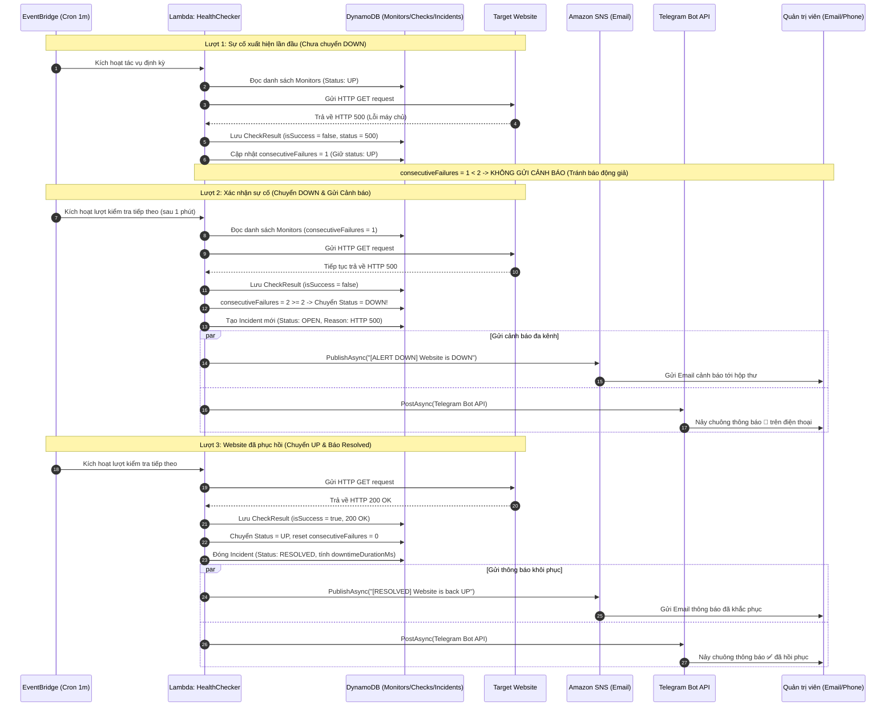

# Các Luồng Sử Dụng Chính (Use Cases)

Tài liệu này mô tả chi tiết các tác nhân (Actors), các luồng nghiệp vụ chính (Use Case Flows) và sơ đồ tuần tự (Sequence Diagrams) của hệ thống **CloudPulse**.

---

## 1. Tác nhân Hệ thống (System Actors)

1. **Người Quản trị (Admin / SRE)**: Người tương tác trực tiếp với giao diện Dashboard để cấu hình, theo dõi và diễn tập kiểm tra.
2. **EventBridge Scheduler (Timer Actor)**: Dịch vụ lập lịch của AWS định kỳ kích hoạt Lambda theo tần suất 1 phút.
3. **Endpoint Đích (Target Service / Mock Target)**: Website hoặc API nhận các request kiểm tra sức khỏe từ CloudPulse.
4. **Hệ thống Cảnh báo (Notification Channels)**: Amazon SNS (Email) và Telegram Bot API chịu trách nhiệm chuyển tải cảnh báo tới người dùng.

---

## 2. Danh mục Các Use Case (Use Case Index)

| Mã Use Case | Tên Use Case | Tác nhân chính | Mục đích |
| :--- | :--- | :--- | :--- |
| **UC-01** | Thêm Endpoint cần giám sát | Admin | Đăng ký URL mới vào hệ thống |
| **UC-02** | Tự động kiểm tra định kỳ | EventBridge Scheduler | Gửi ping HTTP/HTTPS mỗi phút |
| **UC-03** | Kích hoạt kiểm tra tức thì ("Check Now") | Admin | Bấm nút kiểm tra ngay để xem kết quả |
| **UC-04** | Xử lý phát hiện sự cố & Bắn cảnh báo | Lambda HealthChecker | Phát hiện 2 lần lỗi liên tiếp $\rightarrow$ Bắn Email + Telegram |
| **UC-05** | Xử lý khôi phục dịch vụ & Đóng sự cố | Lambda HealthChecker | Nhận diện website sống lại $\rightarrow$ Báo Resolved |
| **UC-06** | Xem biểu đồ độ trễ & Lịch sử sự cố | Admin | Phân tích hiệu năng và lịch sử gián đoạn |
| **UC-07** | Giả lập tạo lỗi qua Mock Target | Admin / Tester | Đổi mã lỗi 200/500/timeout phục vụ chấm thi |

---

## 3. Chi tiết Các Luồng Nghiệp vụ (Detailed Flows)

### UC-01: Thêm Endpoint cần giám sát
* **Điều kiện tiên quyết**: Người quản trị đang mở Dashboard CloudPulse.
* **Luồng chính (Main Flow)**:
  1. Người quản trị bấm nút **"Thêm Monitor"**.
  2. Hệ thống hiển thị hộp thoại Modal yêu cầu nhập Tên và URL.
  3. Người quản trị nhập `https://api.example.com/health` và bấm **"Lưu Endpoint"**.
  4. Giao diện Frontend kiểm tra sơ bộ định dạng URL và dải IP nhạy cảm (SSRF check).
  5. Frontend gửi request `POST /api/monitors` tới API Gateway.
  6. Lambda `CloudPulse.Api` xác thực lại URL qua module `UrlValidator`.
  7. Lambda tạo bản ghi mới với trạng thái ban đầu là `UNKNOWN`, `consecutiveFailures = 0` và lưu vào bảng `Monitors` trong DynamoDB.
  8. Hệ thống trả về HTTP 201 Created kèm dữ liệu endpoint vừa tạo.
  9. Dashboard hiển thị ngay lập tức endpoint mới trong danh sách.
* **Luồng ngoại lệ (Exceptions)**:
  * Nếu URL trỏ về `127.0.0.1`, `169.254.169.254` hoặc IP riêng $\rightarrow$ Hệ thống từ chối và hiển thị thông báo lỗi: *"Cảnh báo SSRF: Địa chỉ IP không được phép giám sát"*.

---

### UC-02 & UC-04 & UC-05: Vòng đời Kiểm tra, Báo lỗi & Khôi phục

Đây là luồng nghiệp vụ quan trọng nhất của hệ thống, thể hiện trọn vẹn State Machine và cơ chế chống báo động giả.

#### Sơ đồ Tuần tự (Sequence Diagram):

---

### UC-03: Kích hoạt Kiểm tra Tức thì ("Check Now")
* **Mục đích**: Giúp người demo kiểm tra ngay lập tức trạng thái mà không phải chờ đợi cron 1 phút của EventBridge.
* **Luồng chính**:
  1. Người quản trị bấm nút **"Check Now"** trên thẻ của một endpoint.
  2. Nút bấm chuyển sang trạng thái loading xoay tròn và vô hiệu hóa click tạm thời.
  3. Frontend gửi request `POST /api/monitors/{id}/check` tới API Gateway.
  4. Lambda `CloudPulse.Api` nhận request, tạo `HttpClient` với timeout 5 giây và gửi request ngay lập tức tới URL đích.
  5. Đồng hồ `Stopwatch` đo thời gian phản hồi chính xác đến mili-giây.
  6. Lambda lưu kết quả vào `CheckResults` và cập nhật trạng thái mới vào `Monitors`.
  7. API trả về mã HTTP 200 kèm kết quả chi tiết trong vòng **$\le 1 - 2$ giây**.
  8. Dashboard cập nhật tức thì màu sắc badge (Xanh nếu 200, Đỏ nếu lỗi) và hiển thị thông báo Toast góc dưới màn hình.

---

### UC-06: Xem Biểu đồ Độ trễ & Lịch sử Sự cố
* **Luồng chính**:
  1. Người quản trị click chọn một endpoint trong danh sách bên trái Dashboard.
  2. Endpoint đó được đánh dấu chọn (Active Selection).
  3. Frontend tự động gọi song song 2 API:
     * `GET /api/monitors/{id}/checks?limit=30`: Lấy 30 lượt kiểm tra gần nhất.
     * `GET /api/monitors/{id}/incidents?limit=10`: Lấy danh sách các sự cố trong quá khứ.
  4. Thành phần `LatencyChart` hiển thị biểu đồ diện tích (AreaChart) thể hiện thời gian phản hồi (ms) theo từng mốc thời gian, tính toán các chip thống kê `MIN / AVG / MAX`.
  5. Thành phần `IncidentHistory` hiển thị danh sách các đợt gián đoạn kèm nhãn `OPEN` (đang chết) hoặc `RESOLVED` (đã xong) cùng thời lượng downtime (ví dụ: `124s downtime`).

---

### UC-07: Giả lập Tạo Lỗi qua Mock Target Service (Kịch bản Demo)
* **Mục đích**: Phục vụ việc thuyết trình đồ án trước hội đồng chấm thi mà không phụ thuộc vào rủi ro đường truyền mạng bên ngoài.
* **Các kịch bản thực hiện**:
  * **Kịch bản 1 (Mô phỏng sập máy chủ HTTP 500)**:
    1. Đăng ký URL `https://.../mock?status=500` vào hệ thống.
    2. Bấm "Check Now" 2 lần liên tiếp $\rightarrow$ Hệ thống chuyển sang `DOWN` màu đỏ $\rightarrow$ Điện thoại và Email nhận cảnh báo sự cố tức thì.
  * **Kịch bản 2 (Mô phỏng máy chủ bị treo / Timeout)**:
    1. Đăng ký URL `https://.../mock?delay=7000` vào hệ thống.
    2. Lambda kiểm tra nhận thấy sau 5.000 ms máy chủ vẫn chưa phản hồi $\rightarrow$ Đánh dấu lỗi `TIMEOUT`.
  * **Kịch bản 3 (Mô phỏng khôi phục hoàn toàn)**:
    1. Đổi URL thành `https://.../mock?status=200`.
    2. Bấm "Check Now" $\rightarrow$ Hệ thống chuyển về `UP` màu xanh $\rightarrow$ Nhận thông báo Resolved.

